> [!NOTE]
> Generated from `projects.yaml`. Edits made here are overwritten; change that file instead.

# What Changes Around Me follows

57 on the list: 5 Focus, 52 watching. 27 have a schedule recorded.

## Open questions
- **765 kV transmission lines**: a Focus project with no schedule recorded.
- **East Ave Trail**: no organization recorded.
- **East Ave Trail**: a Focus project with no schedule recorded.
- **Convention Center**: nothing to link to yet.
- **IHOP downtown site**: no organization recorded.
- **IHOP downtown site**: nothing to link to yet.
- **Lower Colorado River Watershed Restoration and Access Plan**: no organization recorded.

## Schedules
Each chart shows the latest statement. Underneath is everything that has been said, oldest first, and how far each phase has moved between the first and the latest.

### I-35 Capital Express Central
Project · focus · TxDOT

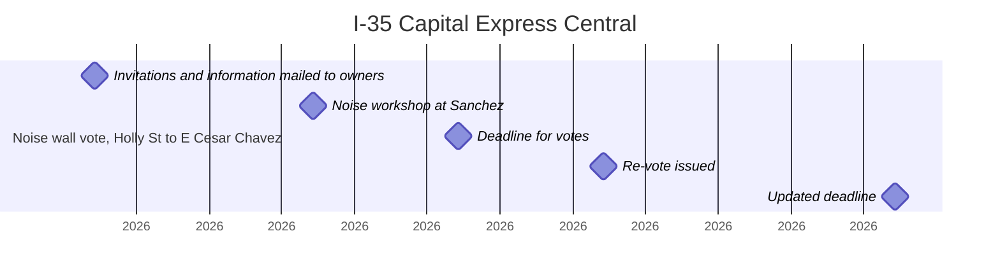

- **Dated 2026-03-25.** TxDOT, provided to Ian — about: Noise wall vote, Holly St to E Cesar Chavez
    - Invitations and information mailed to owners: (read as starting 2026-01-28)
    - Noise workshop at Sanchez: (read as starting 2026-02-18)
    - Deadline for votes: (read as starting 2026-03-04)
    - Re-vote issued: “Re-vote issued (not enough responses)” (read as starting 2026-03-18)
    - Updated deadline: (read as starting 2026-04-15)

### Red Line double tracking and E 5th Street
Project · focus · CapMetro, CoA

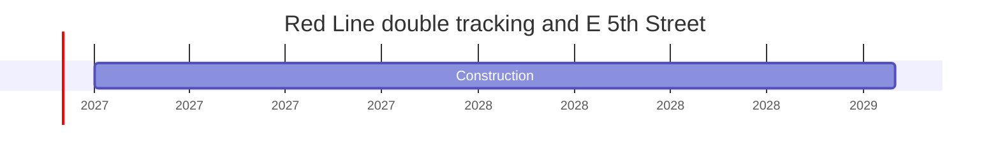

- **Undated.** CapMetro Rail Improvements page on PublicInput ([source](https://publicinput.com/b3355#tab-41279)) *The page carries no date. Whether it came before or after the July 2023 presentation is not known.*
    - Construction: “Construction is planned to occur in 2025 and be completed by the end of the year.” (read as during 2025)
- **Dated 2023-07.** CapMetro presentation ([source](https://drive.google.com/file/d/1XJhYF5Q-E9svEzNgFs5LBhyevkaPXQAU/view))
    - Construction: “construction completion date anticipated in 2026, contingent upon availability of funding” (read as by the end of 2026)
- **Read 2026-10-27.** Rail and Trail Improvements page on PublicInput ([source](https://publicinput.com/railandtrails), [our copy](https://archive.changesaroundme.com/capmetro-rail-and-trail-improvements/2026-10-27-0924.pdf)) *Written before fall 2025, and still on the page when it was read.*
    - Design: “design is scheduled to complete in fall 2025” (read as by the end of 2025-11)
    - Construction: “with construction starting in 2026” (read as starting 2026)
- **Dated 2026-03-10.** CapMetro staff, in conversation at the 100% design open house *As recorded on the Focus page, which footnotes the start date to this conversation.*
    - Construction: “Jan 2027, estimated construction start. Jan 2029, estimated construction completion.” (read as 2027-01 to 2029-01)

**Moved:**
- Construction, start: 2025 → 2027-01, 24 months later.
- Construction, end: 2025 → 2029-01, 37 months later.

### E Cesar Chavez, Pleasant Valley to Shady Ln
Project · focus · CoA

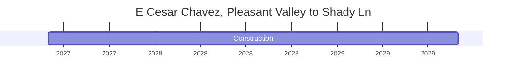

- **Dated 2026-04-03.** Email from the City of Austin's Capital Improvement Program Manager
    - Construction: “Expected to begin ~Summer 2027 and last anywhere between 12-24 months for construction.” (read as 2027-06 to 2029-08)

### Barton Springs Road Bridge
Project · watching · CoA

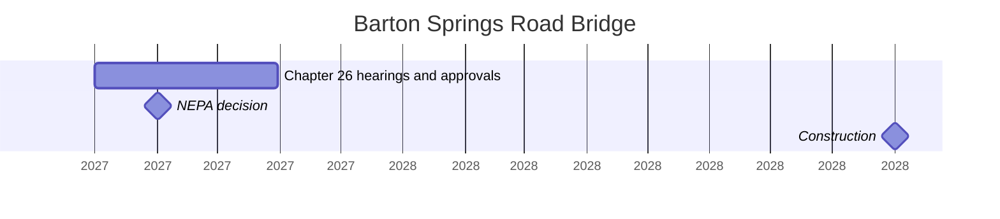

- **Read 2026-10-30.** Project page on PublicInput ([source](https://publicinput.com/x45024), [our copy](https://archive.changesaroundme.com/_unlisted/Barton%20Springs%20Road%20Bridge%20project/2026-10-30-0630.pdf))
    - Chapter 26 hearings and approvals: “Currently targeted for August–October 2027; dates and process are not yet confirmed.” (read as 2027-08 to 2027-10)
    - NEPA decision: “Currently anticipated in late 2027.” (read as starting 2027-09)
    - Construction: “Currently expected to begin in late 2028.” (read as starting 2028-09)

### Burnet Road corridor
Project · watching · CoA

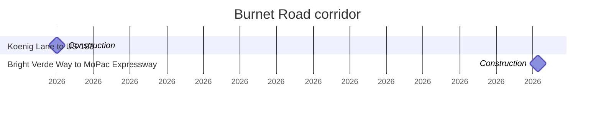

- **Read 2026-09-20.** Project page on PublicInput ([source](https://publicinput.com/n73647), [our copy](https://archive.changesaroundme.com/_unlisted/Burnet%20Road%20corridor%20project/2026-09-20-1109.pdf)) — about: Koenig Lane to US 183
    - Construction: “Construction started in March 2026” (read as starting 2026-03)
- **Read 2026-09-20.** Project page on PublicInput ([source](https://publicinput.com/n73647), [our copy](https://archive.changesaroundme.com/_unlisted/Burnet%20Road%20corridor%20project/2026-09-20-1109.pdf)) — about: Bright Verde Way to MoPac Expressway
    - Construction: “Construction began in June 2026” (read as starting 2026-06)

### South Lamar Boulevard corridor
Project · watching · CoA

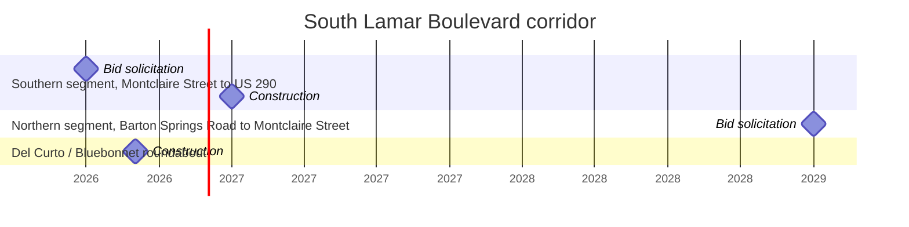

- **Read 2026-11-11.** Speak Up Austin project page ([source](https://www.speakupaustin.org/southlamar), [our copy](https://archive.changesaroundme.com/coa-south-lamar-corridor/2026-11-11-0707.pdf)) — about: Southern segment, Montclaire Street to US 290
    - Bid solicitation: “Bid solicitations began in July 2026.” (read as starting 2026-07)
    - Construction: “Construction is anticipated to start in early 2027.” (read as starting 2027-01)
- **Read 2026-11-11.** Speak Up Austin project page ([source](https://www.speakupaustin.org/southlamar), [our copy](https://archive.changesaroundme.com/coa-south-lamar-corridor/2026-11-11-0707.pdf)) — about: Northern segment, Barton Springs Road to Montclaire Street
    - Bid solicitation: “This segment is expected to go to bid closer to 2029, as the southern segment nears completion.” (read as starting 2029)
- **Read 2026-11-11.** Speak Up Austin project page ([source](https://www.speakupaustin.org/southlamar), [our copy](https://archive.changesaroundme.com/coa-south-lamar-corridor/2026-11-11-0707.pdf)) — about: Del Curto / Bluebonnet roundabout
    - Construction: “Construction is expected to begin in fall 2026.” (read as starting 2026-09)

### East Oltorf Street safety and mobility improvements
Project · watching · CoA

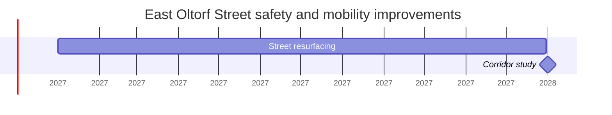

- **Read 2026-11-04.** Speak Up Austin project page ([source](https://www.speakupaustin.org/eastoltorf), [our copy](https://archive.changesaroundme.com/coa-east-oltorf-safety-mobility/2026-11-04-0636.pdf))
    - Street resurfacing: “As part of street resurfacing planned for 2027” (read as during 2027)
    - Corridor study: “The study is expected to begin in early 2028.” (read as starting 2028-01)

### Airport Boulevard corridor
Project · watching · CoA

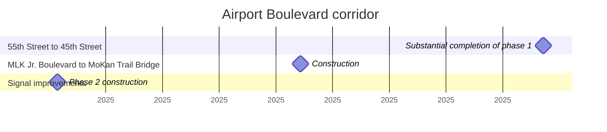

- **Dated 2025-09-15.** City of Austin Airport Boulevard corridor page, construction update of 15 September 2025 ([source](https://experience.arcgis.com/experience/e937439aa3ce44b6b95172e2ae119cb7/page/Home), [our copy](https://archive.changesaroundme.com/coa-airport-corridor/2026-09-20-1524.pdf)) — about: 55th Street to 45th Street
    - Substantial completion of phase 1: “Substantial completion is expected in mid- to late-October 2025.” (read as by the end of 2025-10)
- **Dated 2025-09-15.** City of Austin Airport Boulevard corridor page, construction update of 15 September 2025 ([source](https://experience.arcgis.com/experience/e937439aa3ce44b6b95172e2ae119cb7/page/Home), [our copy](https://archive.changesaroundme.com/coa-airport-corridor/2026-09-20-1524.pdf)) — about: MLK Jr. Boulevard to MoKan Trail Bridge
    - Construction: “Construction is expected to begin by the end of October 2025, pending TxDOT approval.” (read as starting 2025-10)
- **Dated 2025-09-15.** City of Austin Airport Boulevard corridor page, construction update of 15 September 2025 ([source](https://experience.arcgis.com/experience/e937439aa3ce44b6b95172e2ae119cb7/page/Home), [our copy](https://archive.changesaroundme.com/coa-airport-corridor/2026-09-20-1524.pdf)) — about: Signal improvements
    - Phase 2 construction: “construction anticipated to begin fall 2025” (read as starting 2025-09)

### Holly Shores
Project · watching · CoA, TrailCons

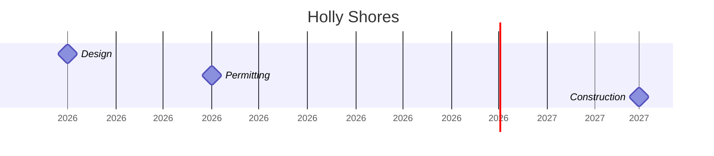

- **Read 2026-11-07.** City of Austin parks project page, "Anticipated Schedule" ([source](https://www.austintexas.gov/parks/projects/holly-shores-edward-rendon-sr-park-festival-beach-vision-plan-implementation), [our copy](https://archive.changesaroundme.com/coa-holly-shores-vision-plan/2026-11-07-0643.pdf))
    - Design: “Spring 2026: Design Phase” (read as starting 2026-03)
    - Permitting: “Summer 2026: Permitting Phase” (read as starting 2026-06)
    - Construction: “Spring 2027: Construction Start” (read as starting 2027-03)

### MoKan Trail
Project · watching · CoA

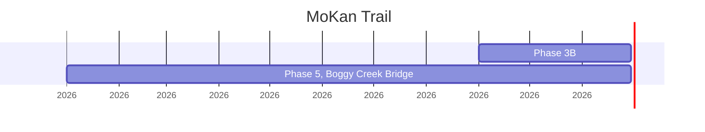

- **Read 2026-09-02.** City of Austin MoKan Trail page ([source](https://data.austintexas.gov/stories/s/MoKan-Trail/9h7i-xcr8/), [our copy](https://archive.changesaroundme.com/coa-mokan-trail/2026-09-02-1548.pdf)) *The page also says construction on phase 5 "began in January 2026" and "is expected to take approximately 10 months to complete".*
    - Phase 3B: “Phase 3B: Fall 2026” (read as 2026-09 to 2026-11)
    - Phase 5, Boggy Creek Bridge: “Phase 5: Winter 2026 - Fall 2026*” (read as 2026-01 to 2026-11)

### 2908 South Congress
Project · watching · CoA

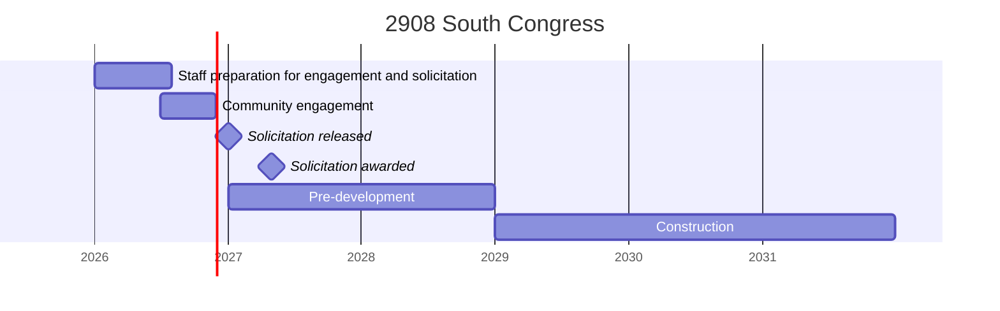

- **Read 2026-09-01.** Speak Up Austin project page, "Anticipated Timeline" table ([source](https://www.speakupaustin.org/2908SouthCongress#tab-83415))
    - Staff preparation for engagement and solicitation: (read as 2026-01 to 2026-07)
    - Community engagement: (read as 2026-07 to 2026-11)
    - Solicitation released: “Jan. 2027” (read as starting 2027-01)
    - Solicitation awarded: “May 2027” (read as starting 2027-05)
    - Pre-development: “Pre-Development 2027-2028” (read as 2027 to 2028)
    - Construction: “Construction Begins: 2029. Construction Completion: 2031.” (read as 2029 to 2031)

### Central City District Plan
Plan · watching · CoA

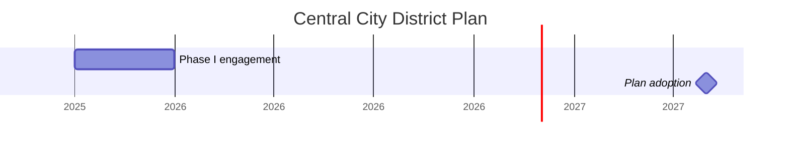

- **Read 2026-11-14.** Speak Up Austin project page ([source](https://www.speakupaustin.org/centralcity), [our copy](https://archive.changesaroundme.com/coa-central-city-district-plan/2026-11-14-0839.pdf))
    - Phase I engagement: “October 2025 - December 2025” (read as 2025-10 to 2025-12)
    - Plan adoption: “The Central City District Plan is set to be proposed to City Council in late Spring 2027.” (read as starting 2027-05)

### East Riverside Corridor Planning Initiative
Plan · watching · CoA

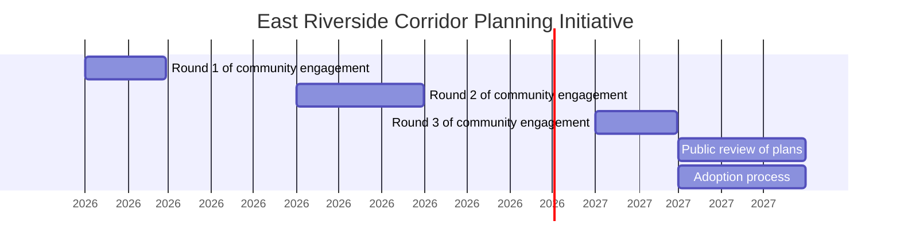

- **Read 2026-11-20.** Speak Up Austin project page ([source](https://www.speakupaustin.org/ERCPlanning), [our copy](https://archive.changesaroundme.com/coa-east-riverside-corridor-planning/2026-11-20-0827.pdf)) *"Winter 2026" and "Winter 2027" are read as the start of those years, from the order the page lists them in.*
    - Round 1 of community engagement: “Winter 2026” (read as 2026-01 to 2026-02)
    - Round 2 of community engagement: “Summer 2026” (read as 2026-06 to 2026-08)
    - Round 3 of community engagement: “Winter 2027” (read as 2027-01 to 2027-02)
    - Public review of plans: “Public Review Plans: Spring 2027” (read as 2027-03 to 2027-05)
    - Adoption process: “Adoption Process: Spring 2027” (read as 2027-03 to 2027-05)

### Imagine Austin Update
Plan · watching · CoA

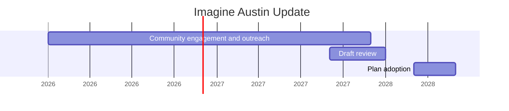

- **Read 2026-11-09.** Speak Up Austin project page ([source](https://www.speakupaustin.org/imagineaustin), [our copy](https://archive.changesaroundme.com/coa-imagine-austin-update/2026-11-09-0711.pdf)) *"Winter 2026" is read as the start of 2026 and "Winter 2027" as the end of 2027, from the order the page lists them in.*
    - Community engagement and outreach: “Winter 2026 - Fall 2027” (read as 2026-01 to 2027-11)
    - Draft review: “Fall - Winter 2027” (read as 2027-09 to 2027-12)
    - Plan adoption: “The Imagine Austin Update is anticipated to be ready for adoption in spring 2028.” (read as 2028-03 to 2028-05)

### Great Streets Plan Update
Plan · watching · CoA

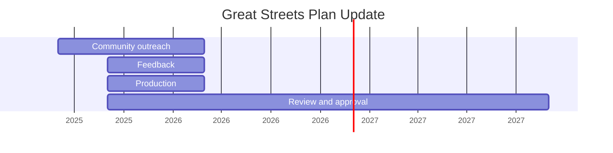

- **Read 2026-11-15.** Speak Up Austin project page ([source](https://www.speakupaustin.org/GreatStreetsUpdate), [our copy](https://archive.changesaroundme.com/coa-great-streets-plan-update/2026-11-15-0645.pdf)) *"Winter 2026" is read as the start of 2026, since it follows 2025 dates.*
    - Community outreach: “Summer 2025 - Winter 2026” (read as 2025-06 to 2026-02)
    - Feedback: “Fall 2025 - Winter 2026” (read as 2025-09 to 2026-02)
    - Production: “Fall 2025 - Winter 2026” (read as 2025-09 to 2026-02)
    - Review and approval: “Fall 2025 - Fall 2027” (read as 2025-09 to 2027-11)

### I-35 Central Small Area Mobility Plan
Plan · watching · CoA

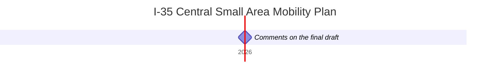

- **Read 2026-09-20.** Speak Up Austin project page ([source](https://www.speakupaustin.org/i35samp), [our copy](https://archive.changesaroundme.com/coa-i35-central-samp/2026-09-20-1119.pdf))
    - Comments on the final draft: “Please review the draft and recommended projects, and share your comments by August 31, 2026.” (read as by the end of 2026-08-31)

### Our Future 35
Plan · watching · CoA

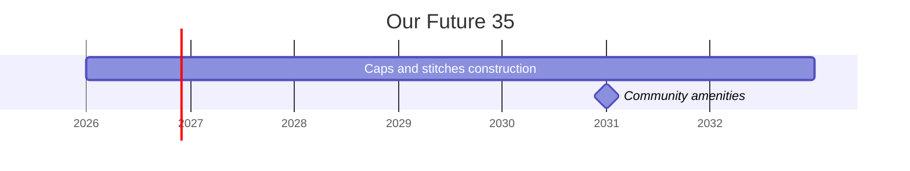

- **Read 2026-10-27.** Speak Up Austin project page, "What is the timeline for construction?" ([source](https://www.speakupaustin.org/of35), [our copy](https://archive.changesaroundme.com/coa-our-future-35/2026-10-27-0901.pdf))
    - Caps and stitches construction: “Caps and stitches will be constructed along with TxDOT’s highway expansion from 2026 to 2032.” (read as 2026 to 2032)
    - Community amenities: “Community amenities will be added after the highway project is complete, starting around 2031 or 2032.” (read as starting 2031)

### East Austin Historic Resource Survey
Plan · watching · CoA

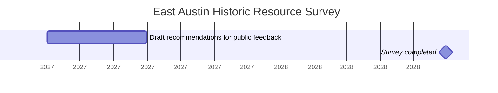

- **Read 2026-10-30.** Speak Up Austin project page ([source](https://www.speakupaustin.org/eastaustinsurvey), [our copy](https://archive.changesaroundme.com/coa-east-austin-historic-resource-survey/2026-10-30-0636.pdf))
    - Draft recommendations for public feedback: “A draft of the survey recommendations will be shared for public feedback in summer 2027.” (read as 2027-06 to 2027-08)
    - Survey completed: “The survey will be completed in the spring of 2028.” (read as by the end of 2028-05)

### Citywide Density Bonus Program
Policy · watching · CoA

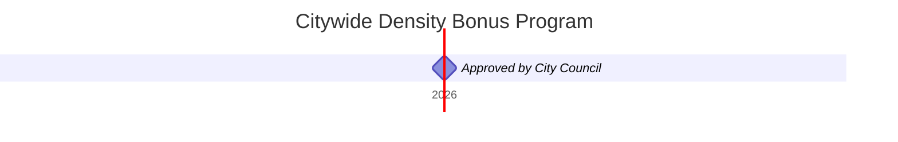

- **Read 2026-10-27.** Speak Up Austin project page ([source](https://www.speakupaustin.org/Citywidedb), [our copy](https://archive.changesaroundme.com/coa-citywide-density-bonus/2026-10-27-0737.pdf))
    - Approved by City Council: “The Citywide Density Bonus Program was approved by City Council on May 21, 2026.” (read as starting 2026-05-21)

### Green Infrastructure Initiative
Policy · watching · CoA

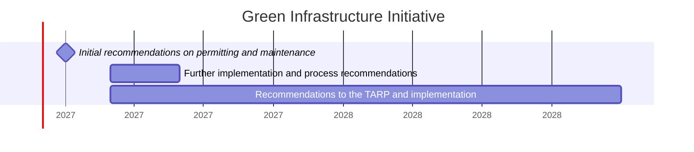

- **Read 2026-11-12.** Speak Up Austin project page ([source](https://www.speakupaustin.org/greeninfrastructure), [our copy](https://archive.changesaroundme.com/coa-green-infrastructure-initiative/2026-11-12-0632.pdf))
    - Initial recommendations on permitting and maintenance: “Staff currently anticipate sharing initial recommendations related to permitting and maintenance approaches in January 2027” (read as starting 2027-01)
    - Further implementation and process recommendations: “followed by additional implementation and process recommendations in Spring 2027” (read as 2027-03 to 2027-05)
    - Recommendations to the TARP and implementation: “Staff currently anticipate sharing initial recommendations to the TARP in Spring 2027, with continued implementation through 2028.” (read as 2027-03 to 2028)

### Shape Austin's 2026 Bond
Policy · watching · CoA

```mermaid
gantt
    title Shape Austin's 2026 Bond
    dateFormat YYYY-MM-DD
    axisFormat %Y
    Task force recommendations to Council :milestone, p1, 2026-05-01, 0d
    Council defines the bond package :milestone, p2, 2026-07-01, 0d
    Election :milestone, p3, 2026-11-03, 0d
    Project details on the bond dashboard :milestone, p4, 2027-01-01, 0d
```

- **Read 2026-11-06.** Speak Up Austin project page ([source](https://speakupaustin.org/bond2026), [our copy](https://archive.changesaroundme.com/coa-shape-austins-2026-bond/2026-11-06-0638.pdf))
    - Task force recommendations to Council: “May 2026: BEATF will present formal recommendations to Council.” (read as starting 2026-05)
    - Council defines the bond package: “July 2026: Council defines bond package” (read as starting 2026-07)
    - Election: “a citywide election to take place on Tuesday, November 3, 2026” (read as starting 2026-11-03)
    - Project details on the bond dashboard: “Detailed project information is expected to be available on the Austin Bond Dashboard in early 2027.” (read as starting 2027-01)

### Austin Light Rail
Project · watching · ATP

```mermaid
gantt
    title Austin Light Rail
    dateFormat YYYY-MM-DD
    axisFormat %Y
    Construction :milestone, p1, 2027-01-01, 0d
```

- **Read 2026-11-07.** Austin Transit Partnership milestones page ([source](https://www.atptx.org/milestones/), [our copy](https://archive.changesaroundme.com/atp-milestones/2026-11-07-0647.pdf))
    - Construction: “marking another major step toward beginning construction in 2027” (read as starting 2027)

### CapMetro service changes
Policy · watching · CapMetro

```mermaid
gantt
    title CapMetro service changes
    dateFormat YYYY-MM-DD
    axisFormat %Y
    section January 2027 service change
    Changes take effect :milestone, p1, 2027-01-10, 0d
```

- **Read 2026-11-01.** CapMetro proposed January 2027 service changes page ([source](https://www.capmetro.org/servicechange/proposed-january-2027-service-changes), [our copy](https://archive.changesaroundme.com/capmetro-service-changes-jan-2027/2026-11-01-0644.pdf)) — about: January 2027 service change
    - Changes take effect: “The following schedule changes begin Sunday, January 10, 2027.” (read as starting 2027-01-10)

### CapMetro fare increase, 2027 and 2029
Policy · watching · CapMetro

```mermaid
gantt
    title CapMetro fare increase, 2027 and 2029
    dateFormat YYYY-MM-DD
    axisFormat %Y
    First increase takes effect :milestone, p1, 2027-01-10, 0d
    Second increase :milestone, p2, 2029-01-01, 0d
```

- **Read 2026-10-02.** CapMetro fare increase page ([source](https://www.capmetro.org/fare/general-fares-overview/fare-increase), [our copy](https://archive.changesaroundme.com/capmetro-fare-increase/2026-10-02-0634.pdf))
    - First increase takes effect: “New fares effective January 10, 2027” (read as starting 2027-01-10)
    - Second increase: “There will be a second fare increase in January 2029.” (read as starting 2029-01)

### 2027–2030 TIP amendments
Policy · watching · CAMPO

```mermaid
gantt
    title 2027–2030 TIP amendments
    dateFormat YYYY-MM-DD
    axisFormat %Y
    section Fall 2026 amendments
    Public hearing :milestone, p1, 2026-09-14, 0d
    Comment period closes :milestone, p2, 2026-09-21, 0d
    Action by the Transportation Policy Board :milestone, p3, 2026-10-04, 0d
```

- **Read 2026-09-21.** CAMPO open house page ([source](https://www.campotexas.org/open-house/2027-2030-tip-amendments-open-house-fall-2026/), [our copy](https://archive.changesaroundme.com/campo-2026-fall-tip-amendments/2026-09-21-2259.pdf)) — about: Fall 2026 amendments
    - Public hearing: “CAMPO’s TPB will hold a public hearing at the September 14, 2026” (read as starting 2026-09-14)
    - Comment period closes: “The comment period is open through September 21, 2026.” (read as by the end of 2026-09-21)
    - Action by the Transportation Policy Board: “anticipated to take action on the amendments at the October 4, 2026 meeting” (read as starting 2026-10-04)

### 290 Extension
Project · watching · CTRMA

```mermaid
gantt
    title 290 Extension
    dateFormat YYYY-MM-DD
    axisFormat %Y
    Project kickoff :milestone, p1, 2025-04-01, 0d
    Community listening sessions :milestone, p2, 2025-09-01, 0d
    Project design began :milestone, p3, 2026-01-01, 0d
    Preliminary schematic layouts open house :p4, 2026-09-01, 2026-10-31
    Draft environmental document :milestone, p5, 2027-05-01, 0d
    Public hearing :p6, 2027-05-01, 2027-12-31
    Final schematic and environmental decision :milestone, p7, 2028-01-01, 0d
```

- **Read 2026-11-20.** 290 Extension open house page, "Project Schedule" ([source](https://290extensionproject.com/openhouse/), [our copy](https://archive.changesaroundme.com/ctrma-290-extension-open-house/2026-11-20-0830.pdf))
    - Project kickoff: “April 2025” (read as starting 2025-04)
    - Community listening sessions: “September 2025” (read as starting 2025-09)
    - Project design began: “Early 2026” (read as starting 2026-01)
    - Preliminary schematic layouts open house: “September and October 2026” (read as 2026-09 to 2026-10)
    - Draft environmental document: “Mid 2027” (read as starting 2027-05)
    - Public hearing: “Mid/Late 2027” (read as 2027-05 to 2027-12)
    - Final schematic and environmental decision: “Early 2028” (read as starting 2028-01)

### Unified Transportation Program
Policy · watching · TxDOT

```mermaid
gantt
    title Unified Transportation Program
    dateFormat YYYY-MM-DD
    axisFormat %Y
    section 2027 UTP
    Adopted by the Texas Transportation Commission :milestone, p1, 2026-08-26, 0d
```

- **Read 2026-11-19.** TxDOT UTP public involvement page ([source](https://www.txdot.gov/projects/planning/utp/utp-public-involvement.html), [our copy](https://archive.changesaroundme.com/txdot-utp-public-involvement/2026-11-19-0912.pdf)) — about: 2027 UTP
    - Adopted by the Texas Transportation Commission: “The 2027 UTP was adopted by the Texas Transportation Commission on Aug. 26, 2026.” (read as starting 2026-08-26)

## Everything on the list

| Name | Kind | Tier | Who | Monitored pages | Statements |
|---|---|---|---|---|---|
| 765 kV transmission lines | project | focus | PUC |  |  |
| E Cesar Chavez, Pleasant Valley to Shady Ln | project | focus | CoA |  | 1 |
| East Ave Trail | project | focus | ? |  |  |
| I-35 Capital Express Central | project | focus | TxDOT |  | 1 |
| Red Line double tracking and E 5th Street | project | focus | CapMetro, CoA | 3 | 4 |
| "Dog's head" annexation and development | policy | watching | CoA |  |  |
| 2027–2030 TIP amendments | policy | watching | CAMPO | 1 | 1 |
| 290 Extension | project | watching | CTRMA | 2 | 1 |
| 2908 South Congress | project | watching | CoA | 1 | 1 |
| 3-4 Dwelling Unit Technical Code Update | policy | watching | CoA | 1 |  |
| Airport Boulevard corridor | project | watching | CoA | 1 | 3 |
| All Ages and Abilities Bicycle Priority Network | plan | watching | CoA | 1 |  |
| Alleyway project south of E Cesar Chavez | project | watching | SGI |  |  |
| Austin Energy Resource, Generation and Climate Protection Plan to 2035 | plan | watching | CoA | 1 |  |
| Austin Light Rail | project | watching | ATP | 4 | 1 |
| Barton Springs Road Bridge | project | watching | CoA | 1 | 1 |
| Burnet Road corridor | project | watching | CoA | 1 | 2 |
| CapMetro fare increase, 2027 and 2029 | policy | watching | CapMetro | 1 | 1 |
| CapMetro service changes | policy | watching | CapMetro | 3 | 1 |
| CapMetro Service Standards and Guidelines 2026 | policy | watching | CapMetro | 1 |  |
| Central City District Plan | plan | watching | CoA | 1 | 1 |
| City budget process | policy | watching | CoA |  |  |
| Citywide Density Bonus Program | policy | watching | CoA | 1 | 1 |
| Convention Center | project | watching | CoA |  |  |
| César Chávez Street renaming | policy | watching | CoA | 2 |  |
| East Austin Historic Resource Survey | plan | watching | CoA | 1 | 1 |
| East Austin parking | policy | watching | CoA | 1 |  |
| East Oltorf Street safety and mobility improvements | project | watching | CoA | 1 | 1 |
| East Riverside Corridor Planning Initiative | plan | watching | CoA | 1 | 1 |
| Eilers (Deep Eddy) Neighborhood Park concept plan | project | watching | CoA | 1 |  |
| ETOD Overlay, phase 2 | policy | watching | CoA | 1 |  |
| Great Streets Plan Update | plan | watching | CoA | 1 | 1 |
| Green Infrastructure Initiative | policy | watching | CoA | 1 | 1 |
| Grove–Riverside site | project | watching | CoA | 1 |  |
| Holly Shores | project | watching | CoA, TrailCons | 2 | 1 |
| I-14 extension | project | watching | TxDOT |  |  |
| I-35 Central Small Area Mobility Plan | plan | watching | CoA | 1 | 1 |
| IHOP downtown site | project | watching | ? |  |  |
| Imagine Austin Update | plan | watching | CoA | 1 | 1 |
| Large Load Demand Management Service | policy | watching | PUC |  |  |
| Large water users | policy | watching | CoA |  |  |
| Lower Colorado River Watershed Restoration and Access Plan | plan | watching | ? |  |  |
| MetroBike / Bikeshare expansion | project | watching | CapMetro | 1 |  |
| MoKan Trail | project | watching | CoA | 1 | 1 |
| Northeast District Plan | plan | watching | CoA | 1 |  |
| Our Future 35 | plan | watching | CoA | 1 | 1 |
| Our Parks, Our Future Long Range Plan | plan | watching | CoA | 1 |  |
| Red Line Trail Study | plan | watching | CapMetro | 1 |  |
| Shape Austin's 2026 Bond | policy | watching | CoA | 1 | 1 |
| Shaping Austin's Economic Development Policy | policy | watching | CoA | 1 |  |
| South Lamar Boulevard corridor | project | watching | CoA | 1 | 3 |
| Texas Triangle Multimodal Strategic Plan | plan | watching | TxDOT |  |  |
| Transit Enhancement Infrastructure Report | plan | watching | CoA | 1 |  |
| Transit Plan 2035 | plan | watching | CapMetro | 1 |  |
| Unified Transportation Program | policy | watching | TxDOT | 1 | 1 |
| Urban Trails Plan | plan | watching | CoA | 2 |  |
| West Campus Transportation Plan | plan | watching | CoA | 1 |  |

Who: ATP = Austin Transit Partnership (ATP); CAMPO = Capital Area Metropolitan Planning Organization (CAMPO); CTRMA = Central Texas Regional Mobility Authority (CTRMA); CapMetro = Capital Metropolitan Transportation Authority (CapMetro); CoA = City of Austin (CoA); PUC = Public Utility Commission of Texas (PUC or PUCT); SGI = Something Good Initiative; TrailCons = The Trail Conservancy (Trail Cons.); TxDOT = Texas Department of Transportation (TxDOT).
