> [!NOTE]
> Heads up: this project leans heavily on AI, and not every line has been reviewed by a human. My buddy Claude and I do our best to get things right, but please check the linked source before relying on a date.

# What Changes Around Me follows

[Changes Around Me](https://changesaroundme.com) follows a hand-picked set of public projects, plans and policies, most of them in Austin, Texas. This page lists them, with what their sources have said about timing and the public meetings that name them. It is generated from `projects.yaml` and the meeting calendars; edits made here are overwritten, so change that file instead.

57 on the list: 5 Focus, 52 watching. 40 have a schedule recorded. 20 are named by a meeting on the calendars.

## How to read this page
- **Focus** and **watching.** A Focus project is one the site's author has written a page about. The rest are watched: they are on the list and the web pages about them are checked for changes.
- **Statements.** A schedule is a list of statements. Each is what one source said about timing at one moment, in the source's own words, with a link to the source and to our saved copy of it where there is one. A statement marked as recorded in the site author's notes is what the author was told and wrote down; it is not a quotation, and is printed without quotation marks.
- **Dated** and **Read.** "Dated" is the date the source itself carries. "Read" is the day the source was read, given when the source carries no date.
- **How wording is read.** The brackets after a quotation give the dates it is taken to mean; "read as" marks wording that names no exact day. A year or a month means some time in it. Spring is March to May, summer June to August and fall September to November; early in a year is January to April, mid May to August and late September to December. "Winter" can mean either end of a year, so it is read from the rest of the page, and the statement says which way.
- **Moved.** A phase has moved when the first statement that dates it and the latest one cannot both be right. Where one of them names only a year, the move is given as a range of months.
- **Meetings.** A meeting on the [calendars](https://changesaroundme.com/calendar) is listed under a project when its title, its agenda or its description uses one of the project's names. Only the wording is compared, so a meeting that discusses a project without naming it is not listed. The two tables at the end of the page show which bodies' agendas are read and every match that was made.
- **Who.** ATP = Austin Transit Partnership; CAMPO = Capital Area Metropolitan Planning Organization; CapMetro = Capital Metropolitan Transportation Authority; CoA = City of Austin; CTRMA = Central Texas Regional Mobility Authority; PUC = Public Utility Commission of Texas; SGI = Something Good Initiative; TrailCons = The Trail Conservancy; TxDOT = Texas Department of Transportation.
- **Monitored pages.** How many web pages about a project are checked for changes and archived. They are listed in [sources.md](sources.md).

## Schedules and meetings
Each chart shows the latest statement, or the latest for each part of a project recorded in parts; a schedule with a single date has no chart. Underneath is every statement recorded here, oldest first, and how far each phase has moved between the first and the latest. Last come the meetings that name the project: those still to come, then the most recent ones held, with the agenda item that names it where the agenda has been read.

### I-35 Capital Express Central
Project · focus · TxDOT · also called CapEx Central, I-35 CapEx

Links: [TxDOT project page](https://www.txdot.gov/mymobility35/projects/capex-central.html)

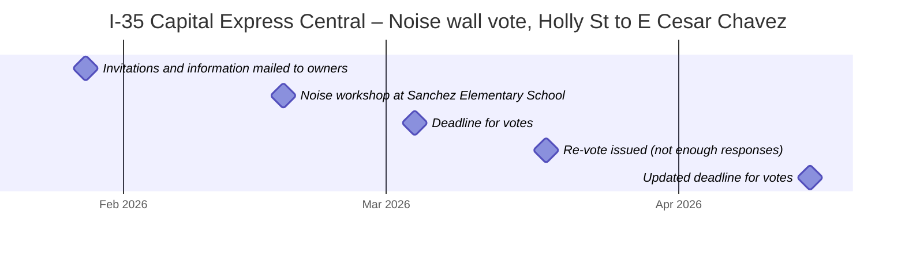

- **Dated 2026-03-25.** Timeline provided by TxDOT to the site's author — about: Noise wall vote, Holly St to E Cesar Chavez — recorded in the site author's notes, not quoted from a document
    - Invitations and information mailed to owners: on 2026-01-28
    - Noise workshop at Sanchez Elementary School: on 2026-02-18
    - Deadline for votes: by 2026-03-04
    - Re-vote issued (not enough responses): on 2026-03-18
    - Updated deadline for votes: by 2026-04-15

### Red Line double tracking and E 5th Street
Project · focus · CapMetro, CoA · also called Rail and Trail Improvements, CapMetro Rail Improvements

Links: [City of Austin Mobility Bond page](https://storymaps.arcgis.com/stories/0c07fae43ac848358a6aa63a3be27d7a)

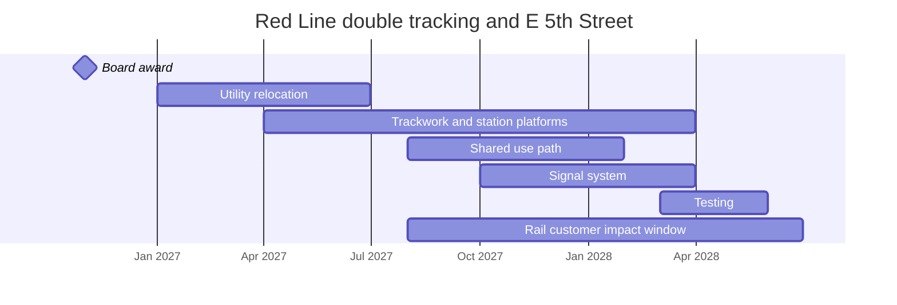

- **Read 2026-09-24.** CapMetro Rail Improvements page on PublicInput ([source](https://publicinput.com/b3355#tab-41279), [our copy](https://archive.changesaroundme.com/capmetro-rail-improvements/2026-09-24-0706.pdf)) *The page carries no date, and this wording was still on it when it was read. Whether it was written before or after the July 2023 presentation is not known.*
    - Construction: “Construction is planned to occur in 2025 and be completed by the end of the year.” (read as 2025 to 2025-12)
- **Dated 2023-07.** CapMetro presentation ([source](https://drive.google.com/file/d/1XJhYF5Q-E9svEzNgFs5LBhyevkaPXQAU/view))
    - Construction: “construction completion date anticipated in 2026, contingent upon availability of funding” (read as by the end of 2026)
- **Read 2026-10-27.** Rail and Trail Improvements page on PublicInput ([source](https://publicinput.com/railandtrails), [our copy](https://archive.changesaroundme.com/capmetro-rail-and-trail-improvements/2026-10-27-0924.pdf)) *Written before fall 2025, and still on the page when it was read.*
    - Design: “design is scheduled to complete in fall 2025” (read as by the end of 2025-11)
    - Construction: “with construction starting in 2026” (read as starting 2026)
- **Dated 2026-03-10.** CapMetro staff, in conversation at the 100% design open house — recorded in the site author's notes, not quoted from a document *The site's page on this project gives both dates and footnotes the start date to this conversation.*
    - Construction: Jan 2027, estimated construction start. Jan 2029, estimated construction completion. (read as 2027-01 to 2029-01)
- **Read 2026-11-24.** Schedule chart titled "Saltillo Station Expansion, Double-Tracking & Shared Use Path – Onion St. to Austin Wye", sent to the site's author by email *The chart prints no dates. Each period is read off its bar against the chart's month columns, to the nearest month. The chart ends with an unlabelled star in late May 2028. News reports of the 16 Nov 2026 board meeting give a spring 2029 finish, which the chart does not show.*
    - Board award: “Board Award” (read as starting 2026-11)
    - Utility relocation: “Utility Relocation” (read as 2027-01 to 2027-06)
    - Trackwork and station platforms: “Trackwork, Station Platforms” (read as 2027-04 to 2028-03)
    - Shared use path: “Shared Use Path” (read as 2027-08 to 2028-01)
    - Signal system: “Signal System” (read as 2027-10 to 2028-03)
    - Testing: “Testing” (read as 2028-03 to 2028-05)
    - Rail customer impact window: “Rail Customer Impact Window During TXDOT I-35/4th Street Bridge Construction” (read as 2027-08 to 2028-06)

**Moved:**
- Construction, start: 13 to 24 months later. 2025 (CapMetro Rail Improvements page on PublicInput, read 2026-09-24) → 2027-01 (CapMetro staff, in conversation at the 100% design open house, dated 2026-03-10).
- Construction, end: 37 months later. 2025-12 (CapMetro Rail Improvements page on PublicInput, read 2026-09-24) → 2029-01 (CapMetro staff, in conversation at the 100% design open house, dated 2026-03-10).

### E Cesar Chavez, Pleasant Valley to Shady Ln
Project · focus · CoA

Links: [Speak Up Austin page](https://www.speakupaustin.org/ColoradoRiverTrail)


- **Dated 2026-04-03.** Email from the City of Austin's Capital Improvement Program Manager
    - Construction: “Expected to begin ~Summer 2027 and last anywhere between 12-24 months for construction.” (read as 2027-06 to 2029-08)

### 765 kV transmission lines
Project · focus · PUC · also called 765-kV, 765 kV

Links: [PUC docket 59029](https://interchange.puc.texas.gov/search/filings/?UtilityType=A&ControlNumber=59029), [PUC docket 59315](https://interchange.puc.texas.gov/search/filings/?UtilityType=A&ControlNumber=59315)

**Past meetings:**
- 21 Aug 2026 · [PUC: Meeting (inc. 765 kV cases)](https://ftp.puc.texas.gov/public/puct-info/agency/om/082126Final.pdf) · “Longshore – Drill Hole (Docket 59029); discussion and possible action.”; “Dinosaur – Longshore (Docket 59315); discussion and possible action.”
- 14 Aug 2026 · [PUC: Open Meeting](https://www.puc.texas.gov/agency/calendar/AppointmentDetail.aspx?ID=1824) · “Docket 59029: 765-kV Longshore Switch - Drill Hole Switch line (Oncor CCN)”
- 29 Jul 2026 · [Texas Senate: Business & Commerce - 765-kV lines and grid reliability](https://capitol.texas.gov/tlodocs/89R/schedules/html/C5102026072909001.HTM)

### Barton Springs Road Bridge
Project · watching · CoA


- **Read 2026-10-30.** Project page on PublicInput ([source](https://publicinput.com/x45024), [our copy](https://archive.changesaroundme.com/_unlisted/Barton%20Springs%20Road%20Bridge%20project/2026-10-30-0630.pdf))
    - Chapter 26 hearings and approvals: “Currently targeted for August–October 2027; dates and process are not yet confirmed.” (read as 2027-08 to 2027-10)
    - NEPA decision: “Currently anticipated in late 2027.” (read as starting 2027-09)
    - Construction: “Currently expected to begin in late 2028.” (read as starting 2028-09)

### Burnet Road corridor
Project · watching · CoA

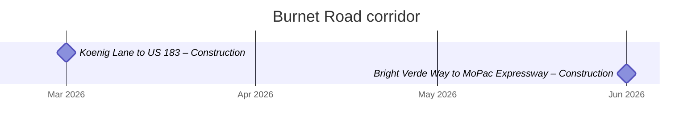

- **Read 2026-09-20.** Project page on PublicInput ([source](https://publicinput.com/n73647), [our copy](https://archive.changesaroundme.com/_unlisted/Burnet%20Road%20corridor%20project/2026-09-20-1109.pdf)) — about: Koenig Lane to US 183
    - Construction: “Construction started in March 2026” (read as starting 2026-03)
- **Read 2026-09-20.** Project page on PublicInput ([source](https://publicinput.com/n73647), [our copy](https://archive.changesaroundme.com/_unlisted/Burnet%20Road%20corridor%20project/2026-09-20-1109.pdf)) — about: Bright Verde Way to MoPac Expressway
    - Construction: “Construction began in June 2026” (read as starting 2026-06)

### South Lamar Boulevard corridor
Project · watching · CoA

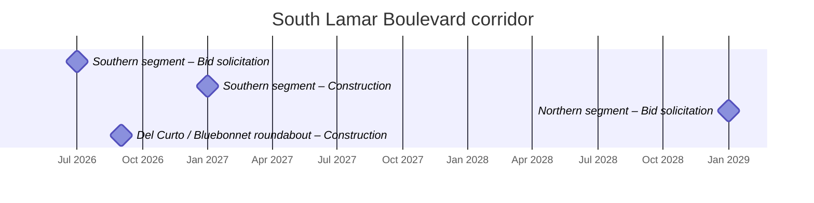

- **Read 2026-11-11.** Speak Up Austin project page ([source](https://www.speakupaustin.org/southlamar), [our copy](https://archive.changesaroundme.com/coa-south-lamar-corridor/2026-11-11-0707.pdf)) — about: Southern segment, Montclaire Street to US 290
    - Bid solicitation: “Bid solicitations began in July 2026.” (read as starting 2026-07)
    - Construction: “Construction is anticipated to start in early 2027.” (read as starting 2027-01)
- **Read 2026-11-11.** Speak Up Austin project page ([source](https://www.speakupaustin.org/southlamar), [our copy](https://archive.changesaroundme.com/coa-south-lamar-corridor/2026-11-11-0707.pdf)) — about: Northern segment, Barton Springs Road to Montclaire Street
    - Bid solicitation: “This segment is expected to go to bid closer to 2029, as the southern segment nears completion.” (read as starting 2029)
- **Read 2026-11-11.** Speak Up Austin project page ([source](https://www.speakupaustin.org/southlamar), [our copy](https://archive.changesaroundme.com/coa-south-lamar-corridor/2026-11-11-0707.pdf)) — about: Del Curto / Bluebonnet roundabout
    - Construction: “Construction is expected to begin in fall 2026.” (read as starting 2026-09)

**Upcoming meetings:**
- 2 Dec 2026 · [Transportation and Public Works - South Lamar Boulevard Corridor Open House](https://www.speakupaustin.org/southlamar)

### East Oltorf Street safety and mobility improvements
Project · watching · CoA

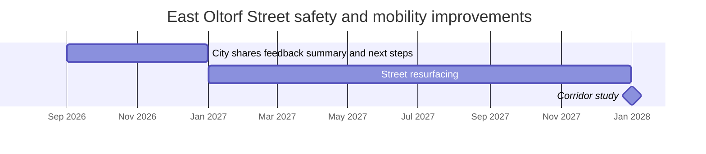

- **Read 2026-11-04.** Speak Up Austin project page ([source](https://www.speakupaustin.org/eastoltorf), [our copy](https://archive.changesaroundme.com/coa-east-oltorf-safety-mobility/2026-11-04-0636.pdf))
    - City shares feedback summary and next steps: “Late 2026” (read as 2026-09 to 2026-12)
    - Street resurfacing: “As part of street resurfacing planned for 2027” (read as during 2027)
    - Corridor study: “The study is expected to begin in early 2028.” (read as starting 2028-01)

### Airport Boulevard corridor
Project · watching · CoA · also called Airport Corridor

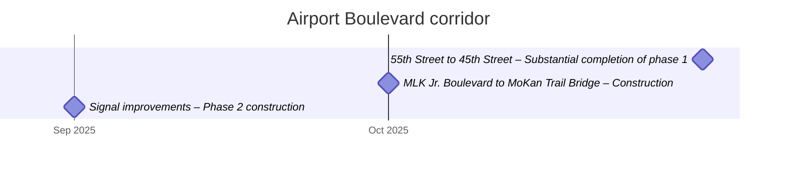

- **Dated 2025-09-15.** City of Austin Airport Boulevard corridor page, construction update of 15 September 2025 ([source](https://experience.arcgis.com/experience/e937439aa3ce44b6b95172e2ae119cb7/page/Home), [our copy](https://archive.changesaroundme.com/coa-airport-corridor/2026-09-20-1524.pdf)) — about: 55th Street to 45th Street
    - Substantial completion of phase 1: “Substantial completion is expected in mid- to late-October 2025.” (read as by the end of 2025-10)
- **Dated 2025-09-15.** City of Austin Airport Boulevard corridor page, construction update of 15 September 2025 ([source](https://experience.arcgis.com/experience/e937439aa3ce44b6b95172e2ae119cb7/page/Home), [our copy](https://archive.changesaroundme.com/coa-airport-corridor/2026-09-20-1524.pdf)) — about: MLK Jr. Boulevard to MoKan Trail Bridge
    - Construction: “Construction is expected to begin by the end of October 2025, pending TxDOT approval.” (read as starting 2025-10)
- **Dated 2025-09-15.** City of Austin Airport Boulevard corridor page, construction update of 15 September 2025 ([source](https://experience.arcgis.com/experience/e937439aa3ce44b6b95172e2ae119cb7/page/Home), [our copy](https://archive.changesaroundme.com/coa-airport-corridor/2026-09-20-1524.pdf)) — about: Signal improvements
    - Phase 2 construction: “construction anticipated to begin fall 2025” (read as starting 2025-09)

### Holly Shores
Project · watching · CoA, TrailCons · also called Edward Rendon Sr. Park at Festival Beach, Eastside Family Garden and Lakefront Trail Park

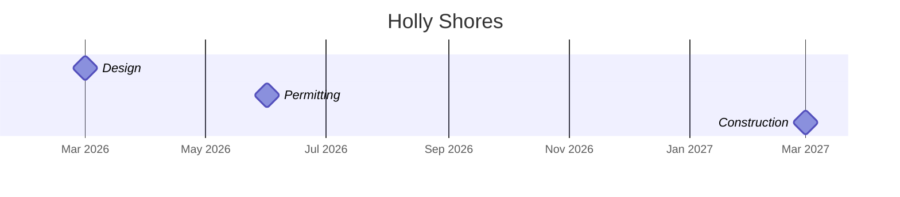

- **Read 2026-11-07.** City of Austin parks project page, "Anticipated Schedule" ([source](https://www.austintexas.gov/parks/projects/holly-shores-edward-rendon-sr-park-festival-beach-vision-plan-implementation), [our copy](https://archive.changesaroundme.com/coa-holly-shores-vision-plan/2026-11-07-0643.pdf))
    - Design: “Spring 2026: Design Phase” (read as starting 2026-03)
    - Permitting: “Summer 2026: Permitting Phase” (read as starting 2026-06)
    - Construction: “Spring 2027: Construction Start” (read as starting 2027-03)

**Past meetings:**
- 10 Oct 2026 · [Trail Cons. - Open House: Eastside Family Garden Design Concepts](https://thetrailconservancy.org/event/design-concepts-eastside-family-garden-project/)
- 15 Nov 2025 · [Trail Cons. - Conversation with the Artist \| Eastside Family Garden Project](https://thetrailconservancy.org/event/community-design-workshop-eastside-family-garden-project/)
- 22 Apr 2025 · [Trail Cons. - Open House – Holly Shores Projects](https://thetrailconservancy.org/event/open-house-holly-shores-projects-2/)
- 12 Apr 2025 · [Trail Cons. - Open House – Holly Shores Projects](https://thetrailconservancy.org/event/open-house-holly-shores-projects/)

### MoKan Trail
Project · watching · CoA

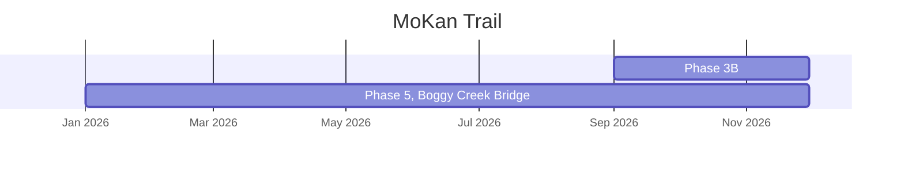

- **Read 2026-09-02.** City of Austin MoKan Trail page ([source](https://data.austintexas.gov/stories/s/MoKan-Trail/9h7i-xcr8/), [our copy](https://archive.changesaroundme.com/coa-mokan-trail/2026-09-02-1548.pdf)) *"Winter 2026" is read as the start of 2026, because the page also says construction on phase 5 "began in January 2026" and "is expected to take approximately 10 months to complete".*
    - Phase 3B: “Phase 3B: Fall 2026” (read as 2026-09 to 2026-11)
    - Phase 5, Boggy Creek Bridge: “Phase 5: Winter 2026 - Fall 2026*” (read as 2026-01 to 2026-11)

### Grove–Riverside site
Project · watching · CoA

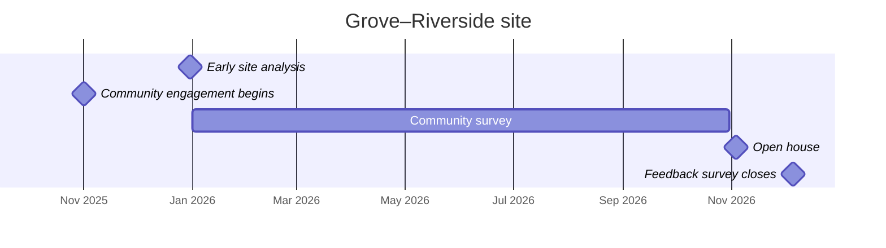

- **Read 2026-11-22.** Speak Up Austin project page ([source](https://www.speakupaustin.org/Grove-Riverside), [our copy](https://archive.changesaroundme.com/coa-grove-riverside-site/2026-11-22-0658.pdf))
    - Early site analysis: “This work was completed in late 2025.” (read as by the end of 2025-12)
    - Community engagement begins: “Beginning in November 2025” (read as starting 2025-11)
    - Community survey: “A survey was made available from January through October 2026” (read as 2026-01 to 2026-10)
    - Open house: “Wednesday November 4, 2026, 6 to 8 pm” (on 2026-11-04)
    - Feedback survey closes: “Survey is open through December 6, 2026.” (by 2026-12-06)

**Past meetings:**
- 29 Aug 2026 · [East Riverside Open House #2](https://www.speakupaustin.org/Grove-Riverside) · “Second East Riverside open house (10am-1pm CDT): city-led projects shaping the East Riverside Corridor in one room, including the Grove-Riverside Site (125…”

### 2908 South Congress
Project · watching · CoA

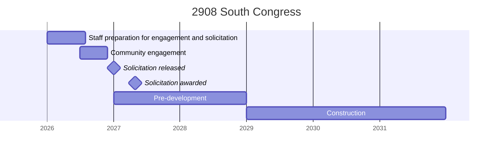

- **Read 2026-09-01.** Speak Up Austin project page, "Anticipated Timeline" table ([source](https://www.speakupaustin.org/2908SouthCongress#tab-83415), [our copy](https://archive.changesaroundme.com/coa-2908-south-congress/2026-09-01-1634.pdf))
    - Staff preparation for engagement and solicitation: “Jan. - July 2026” (read as 2026-01 to 2026-07)
    - Community engagement: “July – Nov. 2026” (read as 2026-07 to 2026-11)
    - Solicitation released: “Jan. 2027” (read as starting 2027-01)
    - Solicitation awarded: “May 2027” (read as starting 2027-05)
    - Pre-development: “2027-2028” (read as 2027 to 2028)
    - Construction: “Construction Begins: 2029. Construction Completion: 2031.” (read as 2029 to 2031)

**Past meetings:**
- 22 Sep 2026 · [AHFC Open Houses - 6200 Menchaca & 2908 South Congress (September)](https://www.speakupaustin.org/2908SouthCongress)
- 24 Aug 2026 · [AHFC Open Houses - 6200 Menchaca & 2908 South Congress (August)](https://www.speakupaustin.org/6200Menchaca)

### Central City District Plan
Plan · watching · CoA

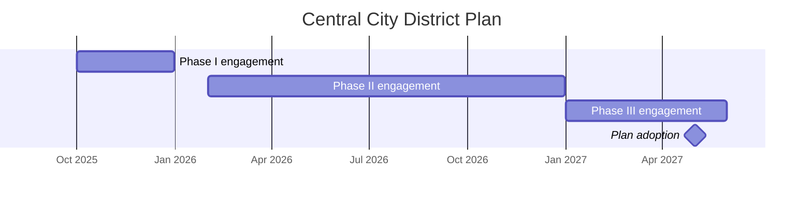

- **Read 2026-11-14.** Speak Up Austin project page ([source](https://www.speakupaustin.org/centralcity), [our copy](https://archive.changesaroundme.com/coa-central-city-district-plan/2026-11-14-0839.pdf))
    - Phase I engagement: “October 2025 - December 2025” (read as 2025-10 to 2025-12)
    - Phase II engagement: “February 2026 - December 2026” (read as 2026-02 to 2026-12)
    - Phase III engagement: “January 2027 - May 2027” (read as 2027-01 to 2027-05)
    - Plan adoption: “The Central City District Plan is set to be proposed to City Council in late Spring 2027.” (read as starting 2027-05)

### Northeast District Plan
Plan · watching · CoA

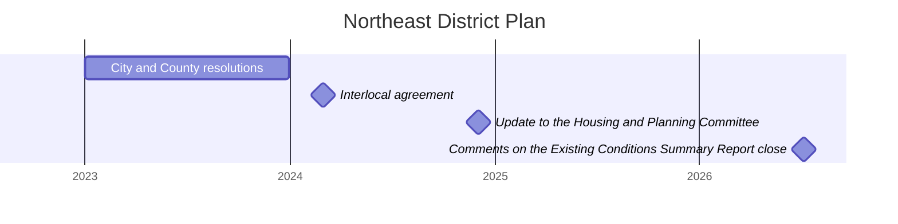

- **Read 2026-11-19.** Speak Up Austin project page ([source](https://www.speakupaustin.org/northeastdistrict), [our copy](https://archive.changesaroundme.com/coa-northeast-district-plan/2026-11-19-0705.pdf)) *The page also says applications for the Community Advisory Committee are open "through November 23rd", without a year.*
    - City and County resolutions: “In 2023, Austin City Council and Travis County Commissioner's Court passed resolutions” (read as during 2023)
    - Interlocal agreement: “followed in March 2024 by an Interlocal Agreement” (read as starting 2024-03)
    - Update to the Housing and Planning Committee: “Date: Tuesday, December 3, 2024” (on 2024-12-03)
    - Comments on the Existing Conditions Summary Report close: “The public comment period closed on July 6, 2026.” (by 2026-07-06)

### East Riverside Corridor Planning Initiative
Plan · watching · CoA

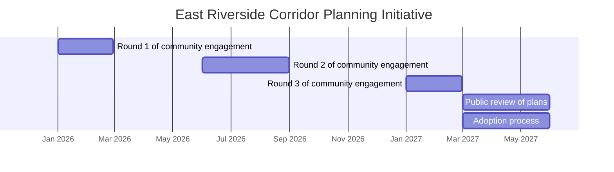

- **Read 2026-11-20.** Speak Up Austin project page ([source](https://www.speakupaustin.org/ERCPlanning), [our copy](https://archive.changesaroundme.com/coa-east-riverside-corridor-planning/2026-11-20-0827.pdf)) *"Winter 2026" and "Winter 2027" are read as the start of those years, from the order the page lists them in.*
    - Round 1 of community engagement: “Winter 2026” (read as 2026-01 to 2026-02)
    - Round 2 of community engagement: “Summer 2026” (read as 2026-06 to 2026-08)
    - Round 3 of community engagement: “Winter 2027” (read as 2027-01 to 2027-02)
    - Public review of plans: “Public Review Plans: Spring 2027” (read as 2027-03 to 2027-05)
    - Adoption process: “Adoption Process: Spring 2027” (read as 2027-03 to 2027-05)

### Imagine Austin Update
Plan · watching · CoA

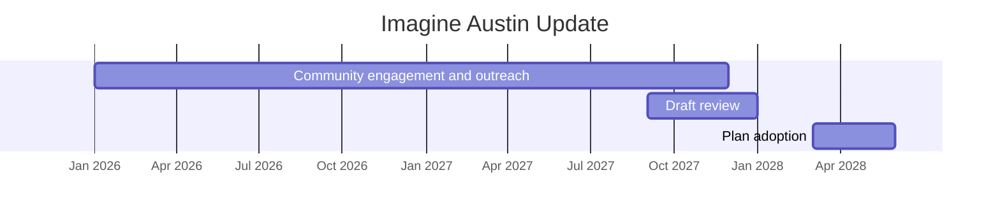

- **Read 2026-11-09.** Speak Up Austin project page ([source](https://www.speakupaustin.org/imagineaustin), [our copy](https://archive.changesaroundme.com/coa-imagine-austin-update/2026-11-09-0711.pdf)) *"Winter 2026" is read as the start of 2026 and "Winter 2027" as the end of 2027, from the order the page lists them in.*
    - Community engagement and outreach: “Winter 2026 - Fall 2027” (read as 2026-01 to 2027-11)
    - Draft review: “Fall - Winter 2027” (read as 2027-09 to 2027-12)
    - Plan adoption: “The Imagine Austin Update is anticipated to be ready for adoption in spring 2028.” (read as 2028-03 to 2028-05)

**Past meetings:**
- 29 Oct 2026 · [Imagine Austin Update - Place Types Virtual Open House](https://publicinput.com/q8361#tab-51953)
- 28 Oct 2026 · [Imagine Austin Update - Place Types Open House (Doss Elementary)](https://publicinput.com/q8361#tab-51953)
- 24 Oct 2026 · [Imagine Austin Update - Place Types Open House (Conley-Guerrero)](https://publicinput.com/q8361#tab-51953)
- 21 Oct 2026 · [Imagine Austin Update - Place Types Open House (Dove Springs)](https://publicinput.com/q8361#tab-51953)
- 20 Oct 2026 · [Imagine Austin Update - Place Types Open House (Turner Roberts)](https://publicinput.com/q8361#tab-51953)

### Great Streets Plan Update
Plan · watching · CoA

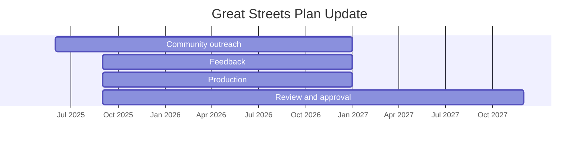

- **Read 2026-11-15.** Speak Up Austin project page ([source](https://www.speakupaustin.org/GreatStreetsUpdate), [our copy](https://archive.changesaroundme.com/coa-great-streets-plan-update/2026-11-15-0645.pdf)) *The page's "Winter 2026" is ambiguous, because winter falls at both ends of a year. It is read as December 2026: the page, read on 15 November 2026, still marks Community Outreach as "Live" and the Feedback and Production steps as "Planned".*
    - Community outreach: “Summer 2025 - Winter 2026” (read as 2025-06 to 2026-12)
    - Feedback: “Fall 2025 - Winter 2026” (read as 2025-09 to 2026-12)
    - Production: “Fall 2025 - Winter 2026” (read as 2025-09 to 2026-12)
    - Review and approval: “Fall 2025 - Fall 2027” (read as 2025-09 to 2027-11)

### I-35 Central Small Area Mobility Plan
Plan · watching · CoA

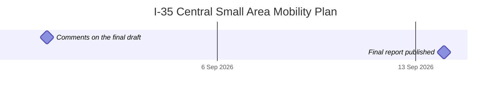

- **Read 2026-09-20.** Speak Up Austin project page ([source](https://www.speakupaustin.org/i35samp), [our copy](https://archive.changesaroundme.com/coa-i35-central-samp/2026-09-20-1119.pdf))
    - Comments on the final draft: “Please review the draft and recommended projects, and share your comments by August 31, 2026.” (by 2026-08-31)
    - Final report published: “Final report published: Sept. 14, 2026” (on 2026-09-14)

### Our Future 35
Plan · watching · CoA · also called Cap and Stitch

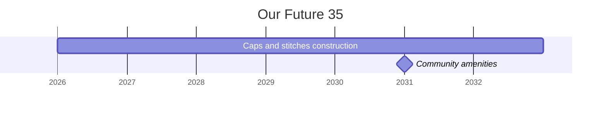

- **Read 2026-10-27.** Speak Up Austin project page, "What is the timeline for construction?" ([source](https://www.speakupaustin.org/of35), [our copy](https://archive.changesaroundme.com/coa-our-future-35/2026-10-27-0901.pdf))
    - Caps and stitches construction: “Caps and stitches will be constructed along with TxDOT’s highway expansion from 2026 to 2032.” (read as 2026 to 2032)
    - Community amenities: “Community amenities will be added after the highway project is complete, starting around 2031 or 2032.” (read as starting 2031)

### West Campus Transportation Plan
Plan · watching · CoA

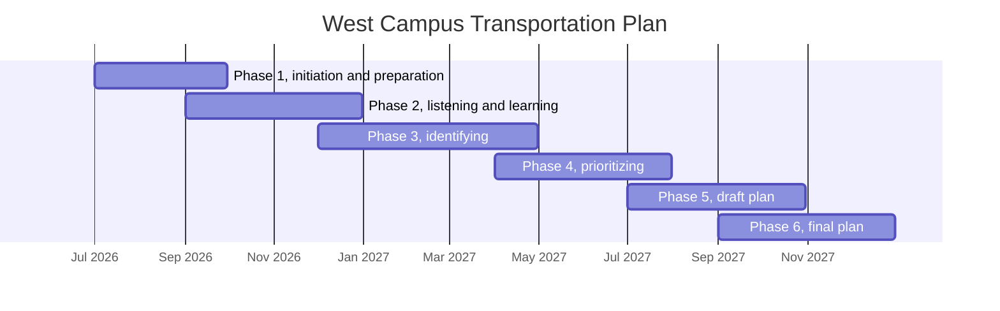

- **Read 2026-11-04.** Speak Up Austin project page ([source](https://www.speakupaustin.org/WestCampus), [our copy](https://archive.changesaroundme.com/coa-west-campus-transportation-plan/2026-11-04-0637.pdf))
    - Phase 1, initiation and preparation: “July–September 2026” (read as 2026-07 to 2026-09)
    - Phase 2, listening and learning: “September–December 2026” (read as 2026-09 to 2026-12)
    - Phase 3, identifying: “December 2026–April 2027” (read as 2026-12 to 2027-04)
    - Phase 4, prioritizing: “April–July 2027” (read as 2027-04 to 2027-07)
    - Phase 5, draft plan: “July–October 2027” (read as 2027-07 to 2027-10)
    - Phase 6, final plan: “September–December 2027” (read as 2027-09 to 2027-12)

### Our Parks, Our Future Long Range Plan
Plan · watching · CoA

```mermaid
gantt
    title Our Parks, Our Future Long Range Plan
    dateFormat YYYY-MM-DD
    axisFormat %b %Y
    tickInterval 2month
    todayMarker off
    Community survey :p1, 2018-11-28, 2019-01-28
    Statistically valid survey :p2, 2019-01-01, 2019-03-31
    Adopted by City Council :milestone, p3, 2019-11-14, 0d
```

- **Read 2026-11-07.** City of Austin parks page ([source](https://www.austintexas.gov/parks/our-parks-our-future-long-range-plan), [our copy](https://archive.changesaroundme.com/coa-parks-long-range-plan/2026-11-07-0642.pdf))
    - Community survey: “Open from November 28, 2018 to January 28, 2019” (2018-11-28 to 2019-01-28)
    - Statistically valid survey: “Conducted by ETC from January 2019 to March 2019” (read as 2019-01 to 2019-03)
    - Adopted by City Council: “adopting the Parks and Recreation Long Range Plan for Land, Facilities and Programs on November 14, 2019” (on 2019-11-14)

### Austin Energy Resource, Generation and Climate Protection Plan to 2035
Plan · watching · CoA

```mermaid
gantt
    title Austin Energy Resource, Generation and Climate Protection Plan to 2035
    dateFormat YYYY-MM-DD
    axisFormat %b %Y
    tickInterval 3month
    todayMarker off
    Resource Generation Plan survey :milestone, p1, 2023-08-01, 0d
    Energy Reliability Workshops :milestone, p2, 2026-04-01, 0d
```

- **Read 2026-09-20.** Austin Energy plan page on PublicInput ([source](https://publicinput.com/generation), [our copy](https://archive.changesaroundme.com/coa-austin-energy-resource-generation-plan-2035/2026-09-20-1127.pdf)) *The page also mentions "the Austin City Council’s May 21 approval" of new energy contracts, without a year.*
    - Resource Generation Plan survey: “In August 2023, Austin Energy invited customers to provide feedback on energy generation options and priorities.” (read as starting 2023-08)
    - Energy Reliability Workshops: “In April 2026, Austin Energy hosted a series of Energy Reliability Workshops across Austin.” (read as starting 2026-04)

### Transit Enhancement Infrastructure Report
Plan · watching · CoA

```mermaid
gantt
    title Transit Enhancement Infrastructure Report
    dateFormat YYYY-MM-DD
    axisFormat %Y
    tickInterval 12month
    todayMarker off
    Report published :milestone, p1, 2024-04-01, 0d
    Bond-funded projects completed :milestone, p2, 2028-12-31, 0d
```

- **Dated 2024-04.** City of Austin Transit Enhancement Infrastructure Report page ([source](https://www.austintexas.gov/transportation-public-works/transit-enhancement-infrastructure-report), [our copy](https://archive.changesaroundme.com/coa-transit-enhancement-infrastructure-report/2026-11-07-0632.pdf))
    - Report published: “Published April 2024” (read as starting 2024-04)
    - Bond-funded projects completed: “Projects using bond funds should be completed by 2028.” (read as by the end of 2028)

### East Austin Historic Resource Survey
Plan · watching · CoA

```mermaid
gantt
    title East Austin Historic Resource Survey
    dateFormat YYYY-MM-DD
    axisFormat %b %Y
    tickInterval 2month
    todayMarker off
    Draft recommendations for public feedback :p1, 2027-06-01, 2027-08-31
    Survey completed :milestone, p2, 2028-05-31, 0d
```

- **Read 2026-10-30.** Speak Up Austin project page ([source](https://www.speakupaustin.org/eastaustinsurvey), [our copy](https://archive.changesaroundme.com/coa-east-austin-historic-resource-survey/2026-10-30-0636.pdf))
    - Draft recommendations for public feedback: “A draft of the survey recommendations will be shared for public feedback in summer 2027.” (read as 2027-06 to 2027-08)
    - Survey completed: “The survey will be completed in the spring of 2028.” (read as by the end of 2028-05)

### Citywide Density Bonus Program
Policy · watching · CoA · also called C20-2024-004

- **Read 2026-10-27.** Speak Up Austin project page ([source](https://www.speakupaustin.org/Citywidedb), [our copy](https://archive.changesaroundme.com/coa-citywide-density-bonus/2026-10-27-0737.pdf))
    - Approved by City Council: “The Citywide Density Bonus Program was approved by City Council on May 21, 2026.” (on 2026-05-21)

### ETOD Overlay, phase 2
Policy · watching · CoA · also called Equitable Transit-Oriented Development

- **Read 2026-09-20.** Speak Up Austin project page ([source](https://www.speakupaustin.org/etodoverlayphase2), [our copy](https://archive.changesaroundme.com/coa-etod-overlay-phase-2/2026-09-20-1116.pdf)) *The first wording is under "What is next for the ETOD Overlay?" and the second under "Welcome!", both in the same capture. The Citywide Density Bonus Program has its own entry in this list.*
    - Goes before City Council: “This project is expected to go before Council in 2026.” (read as during 2026)
    - Approved by City Council as the Citywide Density Bonus Program: “was approved by Council in 2026” (read as during 2026)

### 3-4 Dwelling Unit Technical Code Update
Policy · watching · CoA

**Upcoming meetings:**
- 27 Nov 2026 · [Development Services - 3-4 Dwelling Unit Technical Code Update public comments close](https://publicinput.com/3-4_dwellingcode)

**Past meetings:**
- 12 Nov 2026 · [Development Services - 3-4 Dwelling Unit Technical Code Update Virtual Meeting](https://publicinput.com/3-4_dwellingcode)

### Green Infrastructure Initiative
Policy · watching · CoA

```mermaid
gantt
    title Green Infrastructure Initiative
    dateFormat YYYY-MM-DD
    axisFormat %b %Y
    tickInterval 3month
    todayMarker off
    Phase 1, initial recommendations on permitting and maintenance :milestone, p1, 2027-01-01, 0d
    Phase 1, further implementation and process recommendations :p2, 2027-03-01, 2027-05-31
    Phase 2, recommendations to the TARP and implementation :p3, 2027-03-01, 2028-12-31
```

- **Read 2026-11-12.** Speak Up Austin project page ([source](https://www.speakupaustin.org/greeninfrastructure), [our copy](https://archive.changesaroundme.com/coa-green-infrastructure-initiative/2026-11-12-0632.pdf)) *TARP is the City's Technical Advisory Review Panel. The page calls phase 1 "License Agreements for Street Trees" and phase 2 "Criteria Manual and Code Updates".*
    - Phase 1, initial recommendations on permitting and maintenance: “Staff currently anticipate sharing initial recommendations related to permitting and maintenance approaches in January 2027” (read as starting 2027-01)
    - Phase 1, further implementation and process recommendations: “followed by additional implementation and process recommendations in Spring 2027” (read as 2027-03 to 2027-05)
    - Phase 2, recommendations to the TARP and implementation: “Staff currently anticipate sharing initial recommendations to the TARP in Spring 2027, with continued implementation through 2028.” (read as 2027-03 to 2028)

### Shape Austin's 2026 Bond
Policy · watching · CoA

```mermaid
gantt
    title Shape Austin's 2026 Bond
    dateFormat YYYY-MM-DD
    axisFormat %b %Y
    tickInterval 1month
    todayMarker off
    Task force recommendations to Council :milestone, p1, 2026-05-01, 0d
    Council defines the bond package :milestone, p2, 2026-07-01, 0d
    Election :milestone, p3, 2026-11-03, 0d
    Project details on the bond dashboard :milestone, p4, 2027-01-01, 0d
```

- **Read 2026-11-06.** Speak Up Austin project page ([source](https://speakupaustin.org/bond2026), [our copy](https://archive.changesaroundme.com/coa-shape-austins-2026-bond/2026-11-06-0638.pdf))
    - Task force recommendations to Council: “May 2026: BEATF will present formal recommendations to Council.” (read as starting 2026-05)
    - Council defines the bond package: “July 2026: Council defines bond package” (read as starting 2026-07)
    - Election: “a citywide election to take place on Tuesday, November 3, 2026” (on 2026-11-03)
    - Project details on the bond dashboard: “Detailed project information is expected to be available on the Austin Bond Dashboard in early 2027.” (read as starting 2027-01)

**Past meetings:**
- 23 Jul 2026 · [City Council](https://austintexas.legistar.com/MeetingDetail.aspx?LEGID=4074&GID=684&G=4BED8896) · item 2: “Approve an ordinance ordering a General Obligation Bond Election to be held on November 3, 2026, in the City of Austin, Texas on a proposed bond issue for Park…”
- 21 Jul 2026 · [City Council: Work Session](https://austintexas.legistar.com/MeetingDetail.aspx?LEGID=4085&GID=684&G=4BED8896) · item 2: “Approve an ordinance ordering a General Obligation Bond Election to be held on November 3, 2026, in the City of Austin, Texas on a proposed bond issue for Park…”

### Shaping Austin's Economic Development Policy
Policy · watching · CoA

- **Read 2026-11-07.** City of Austin project page ([source](https://www.austintexas.gov/AustinEconomicPolicy), [our copy](https://archive.changesaroundme.com/coa-shaping-economic-development-policy/2026-11-07-0631.pdf))
    - Council directs the City Manager to develop the policy: “On May 7, 2026, Austin City Council directed the City Manager to develop and present a comprehensive Economic Development Policy for Council consideration.” (on 2026-05-07)

**Upcoming meetings:**
- 14 Jan 2027 · [Austin Economic Development - Economic Development Policy Engagement Session](https://www.eventbrite.com/e/austins-economic-growth-a-community-engagement-session-tickets-2003481938410)
- 23 Jan 2027 · [Austin Economic Development - Economic Development Policy Engagement Session](https://www.eventbrite.com/e/austins-economic-growth-a-community-engagement-session-tickets-2003482010626)
- 27 Jan 2027 · [Austin Economic Development - Economic Development Policy Engagement Session (Virtual)](https://www.eventbrite.com/e/austins-economic-growth-a-community-engagement-session-virtual-tickets-1998904693748)
- 4 Feb 2027 · [Austin Economic Development - Economic Development Policy Engagement Session (Virtual)](https://www.eventbrite.com/e/austins-economic-growth-a-community-engagement-session-virtual-tickets-2003481790969)
- 10 Feb 2027 · [Austin Economic Development - Economic Development Policy Engagement Session](https://www.eventbrite.com/e/austins-economic-growth-a-community-engagement-session-tickets-1998931021495)

**Past meetings:**
- 23 Sep 2026 · [Austin Economic Development - Economic Development Policy Engagement Session](https://www.eventbrite.com/e/austins-economic-growth-a-community-engagement-session-tickets-1998248426836)
- 12 Sep 2026 · [Austin Economic Development - Economic Development Policy Engagement Session](https://www.eventbrite.com/e/austins-economic-growth-a-community-engagement-session-tickets-1998249694628)

### César Chávez Street renaming
Policy · watching · CoA

- **Read 2026-09-20.** Speak Up Austin project page ([source](https://www.speakupaustin.org/renaming-cesar-chavez-project), [our copy](https://archive.changesaroundme.com/coa-cesar-chavez-renaming/2026-09-20-1113.pdf))
    - Process, costs and timeline presented to City Council: “City staff provided a memo and presented the general process, costs, and timeline during the May 26, 2026 City Council Work Session.” (on 2026-05-26)

**Past meetings:**
- 18 Aug 2026 · [CoA: César Chávez St Renaming](https://www.speakupaustin.org/r31038)
- 15 Aug 2026 · [CoA: César Chávez St Renaming](https://www.speakupaustin.org/r31038)
- 11 Aug 2026 · [CoA: César Chávez St Renaming](https://www.speakupaustin.org/r31038)

### City budget process
Policy · watching · CoA

Links: [City budget page](http://austintexas.gov/budget)

**Upcoming meetings:**
- 28 Apr 2027 · [City Council: Budget Meeting](https://www.austintexas.gov/council/meetings)
- 15 Jul 2027 · [City Council: Budget Meeting](https://www.austintexas.gov/council/meetings)
- 21 Jul 2027 · [City Council: Budget Meeting](https://www.austintexas.gov/council/meetings)
- 28 Jul 2027 · [City Council: Budget Meeting](https://www.austintexas.gov/council/meetings)
- 29 Jul 2027 · [City Council: Budget Meeting](https://www.austintexas.gov/council/meetings)
- 3 Aug 2027 · [City Council: Budget Meeting](https://www.austintexas.gov/council/meetings)
- 5 Aug 2027 · [City Council: Budget Meeting](https://www.austintexas.gov/council/meetings)
- 11 Aug 2027 · [City Council: Budget Meeting](https://www.austintexas.gov/council/meetings)
- 12 Aug 2027 · [City Council: Budget Meeting](https://www.austintexas.gov/council/meetings)
- 13 Aug 2027 · [City Council: Budget Meeting](https://www.austintexas.gov/council/meetings)
- 16 Aug 2027 · [City Council: Budget Meeting](https://www.austintexas.gov/council/meetings)

**Past meetings:**
- 17 Aug 2026 · [City Council: Budget Meeting](https://www.austintexas.gov/council/meetings)
- 14 Aug 2026 · [City Council: Budget Meeting](https://www.austintexas.gov/council/meetings)
- 13 Aug 2026 · [City Council: Budget Meeting](https://www.austintexas.gov/council/meetings)
- 12 Aug 2026 · [City Council: Budget Meeting](https://www.austintexas.gov/council/meetings)
- 10 Aug 2026 · [CoA: District 3 Budget Community Meeting](https://docs.google.com/forms/d/e/1FAIpQLScJpPoP8OLVrteDQTlahCP9fyRYws22Hy4CGv3PBXzF5Ktpnw/viewform)
- and 6 earlier

### Austin Light Rail
Project · watching · ATP · also called Austin Light Rail Phase 1, Project Connect

- **Read 2026-11-07.** Austin Transit Partnership milestones page ([source](https://www.atptx.org/milestones/), [our copy](https://archive.changesaroundme.com/atp-milestones/2026-11-07-0647.pdf))
    - Construction: “marking another major step toward beginning construction in 2027” (read as starting 2027)

**Past meetings:**
- 29 Aug 2026 · [East Riverside Open House #2](https://www.speakupaustin.org/Grove-Riverside) · “…including the Grove-Riverside Site (125 acres of City-owned land), Project Connect / Austin Light Rail, and the East Riverside planning and ETOD efforts.…”
- 13 Aug 2026 · [ATP: Community Advisory Committee Meeting](https://www.atptx.org/event/community-advisory-committee-meeting-6-2025-12/2026-08-13/) · “CoA Project Connect Budget Presentation”

### Red Line Trail Study
Plan · watching · CapMetro

```mermaid
gantt
    title Red Line Trail Study
    dateFormat YYYY-MM-DD
    axisFormat %b %Y
    tickInterval 3month
    todayMarker off
    Study launched :milestone, p1, 2023-02-01, 0d
    Stakeholder collaboration and visioning :p2, 2023-03-01, 2023-05-31
    Case studies and plan review :p3, 2023-03-01, 2023-05-31
    Existing conditions and needs assessment :p4, 2023-04-01, 2024-01-31
    Development of processes and guidelines :p5, 2023-09-01, 2024-02-29
    Preliminary trail possibilities :p6, 2024-03-01, 2024-05-31
    Final report with trail recommendations and cost opinions :p7, 2024-06-01, 2024-08-31
```

- **Dated 2024-05.** CapMetro Red Line Trail Study story map, "Virtual Open House: Preliminary Trail Possibilities" ([source](https://storymaps.arcgis.com/stories/476619a08688420b8132a2f3fbb496e2), [our copy](https://archive.changesaroundme.com/capmetro-red-line-trail-study/2026-11-10-0824.pdf))
    - Study launched: “launched the Red Line Trail Study in February 2023” (read as starting 2023-02)
    - Stakeholder collaboration and visioning: “March 2023 - May 2023” (read as 2023-03 to 2023-05)
    - Case studies and plan review: “March 2023 - May 2023” (read as 2023-03 to 2023-05)
    - Existing conditions and needs assessment: “April 2023 - January 2024” (read as 2023-04 to 2024-01)
    - Development of processes and guidelines: “September 2023 - February 2024” (read as 2023-09 to 2024-02)
    - Preliminary trail possibilities: “Spring 2024” (read as 2024-03 to 2024-05)
    - Final report with trail recommendations and cost opinions: “Summer 2024” (read as 2024-06 to 2024-08)

### Transit Plan 2035
Plan · watching · CapMetro

- **Read 2026-10-05.** CapMetro Transit Plan 2035 page ([source](https://www.capmetro.org/transit-plan-2035), [our copy](https://archive.changesaroundme.com/capmetro-transit-plan-2035/2026-10-05-0635.pdf))
    - Approved by the CapMetro Board: “The final plan was presented and approved by the Board of Directors in October 2025.” (read as starting 2025-10)

### CapMetro service changes
Policy · watching · CapMetro

- **Read 2026-11-01.** CapMetro approved January 2027 service changes page ([source](https://www.capmetro.org/servicechange/proposed-january-2027-service-changes), [our copy](https://archive.changesaroundme.com/capmetro-service-changes-jan-2027/2026-11-01-0644.pdf)) — about: January 2027 service change
    - Changes take effect: “The following schedule changes begin Sunday, January 10, 2027.” (on 2027-01-10)

### CapMetro fare increase, 2027 and 2029
Policy · watching · CapMetro

```mermaid
gantt
    title CapMetro fare increase, 2027 and 2029
    dateFormat YYYY-MM-DD
    axisFormat %b %Y
    tickInterval 3month
    todayMarker off
    First increase takes effect :milestone, p1, 2027-01-10, 0d
    Second increase :milestone, p2, 2029-01-01, 0d
```

- **Read 2026-10-02.** CapMetro fare increase page ([source](https://www.capmetro.org/fare/general-fares-overview/fare-increase), [our copy](https://archive.changesaroundme.com/capmetro-fare-increase/2026-10-02-0634.pdf))
    - First increase takes effect: “New fares effective January 10, 2027” (on 2027-01-10)
    - Second increase: “There will be a second fare increase in January 2029.” (read as starting 2029-01)

**Past meetings:**
- 28 Sep 2026 · [CapMetro: Fare increase comments close](https://www.capmetro.org/fare/general-fares-overview/fare-increase)
- 16 Sep 2026 · [CapMetro: Fare Increase Hearing](https://www.capmetro.org/fare/general-fares-overview/fare-increase)
- 19 Aug 2026 · [CapMetro: Fare Increase Meeting](https://www.capmetro.org/fare/general-fares-overview/fare-increase)
- 18 Aug 2026 · [CapMetro: Fare Increase Meeting](https://www.capmetro.org/fare/general-fares-overview/fare-increase)
- 6 Aug 2026 · [CapMetro: Fare Increase Meeting](https://www.capmetro.org/fare/general-fares-overview/fare-increase)
- and 1 earlier

### CapMetro Service Standards and Guidelines 2026
Policy · watching · CapMetro

- **Read 2026-11-15.** CapMetro "Standards, Specifications and Guidelines" page ([source](https://www.capmetro.org/aboutus/about-capmetro/plans-development/standards-specifications-guidelines), [our copy](https://archive.changesaroundme.com/capmetro-service-standards-guidelines/2026-11-15-0727.pdf)) *The page also gives a "public hearing on December 14 at noon", without a year.*
    - Presented to the CapMetro Board for adoption: “We will include the input from the public before presenting to the CapMetro Board for adoption in January 2027.” (read as starting 2027-01)

**Upcoming meetings:**
- 14 Dec 2026 · [CapMetro - Board of Directors + Public Hearing on 2026 Service Standards and Guidelines](https://www.capmetro.org/aboutus/about-capmetro/plans-development/standards-specifications-guidelines)

### MetroBike / Bikeshare expansion
Project · watching · CapMetro

```mermaid
gantt
    title MetroBike / Bikeshare expansion
    dateFormat YYYY-MM-DD
    axisFormat %-d %b %Y
    tickInterval 1week
    todayMarker off
    Open house :milestone, p1, 2024-05-18, 0d
    Comments close :milestone, p2, 2024-06-16, 0d
```

- **Read 2026-10-05.** MetroBike virtual open house page on PublicInput ([source](https://publicinput.com/metrobike), [our copy](https://archive.changesaroundme.com/capmetro-metrobike-open-house/2026-10-05-0637.pdf))
    - Open house: “the in-person MetroBike open house held on Saturday, May 18th, 2024” (on 2024-05-18)
    - Comments close: “Comments will be collected through Sunday, June 16th, 2024.” (by 2024-06-16)

### 2027–2030 TIP amendments
Policy · watching · CAMPO · also called Transportation Improvement Program

```mermaid
gantt
    title 2027–2030 TIP amendments – Fall 2026 amendments
    dateFormat YYYY-MM-DD
    axisFormat %-d %b %Y
    tickInterval 1week
    todayMarker off
    Public hearing :milestone, p1, 2026-09-14, 0d
    Comment period closes :milestone, p2, 2026-09-21, 0d
    Action by the Transportation Policy Board :milestone, p3, 2026-10-04, 0d
```

- **Read 2026-09-21.** CAMPO open house page ([source](https://www.campotexas.org/open-house/2027-2030-tip-amendments-open-house-fall-2026/), [our copy](https://archive.changesaroundme.com/campo-2026-fall-tip-amendments/2026-09-21-2259.pdf)) — about: Fall 2026 amendments *4 October 2026 was a Sunday. CAMPO's calendar lists the Transportation Policy Board meeting on Monday, 5 October 2026.*
    - Public hearing: “CAMPO’s TPB will hold a public hearing at the September 14, 2026” (on 2026-09-14)
    - Comment period closes: “The comment period is open through September 21, 2026.” (by 2026-09-21)
    - Action by the Transportation Policy Board: “anticipated to take action on the amendments at the October 4, 2026 meeting” (on 2026-10-04)

### 290 Extension
Project · watching · CTRMA

```mermaid
gantt
    title 290 Extension
    dateFormat YYYY-MM-DD
    axisFormat %b %Y
    tickInterval 3month
    todayMarker off
    Project kickoff :milestone, p1, 2025-04-01, 0d
    Community listening sessions :milestone, p2, 2025-09-01, 0d
    Project design began :milestone, p3, 2026-01-01, 0d
    Preliminary schematic layouts open house :p4, 2026-09-01, 2026-10-31
    Draft environmental document :milestone, p5, 2027-05-01, 0d
    Public hearing :p6, 2027-05-01, 2027-12-31
    Final schematic and environmental decision :milestone, p7, 2028-01-01, 0d
```

- **Read 2026-11-20.** 290 Extension open house page, "Project Schedule" ([source](https://290extensionproject.com/openhouse/), [our copy](https://archive.changesaroundme.com/ctrma-290-extension-open-house/2026-11-20-0830.pdf))
    - Project kickoff: “April 2025” (read as starting 2025-04)
    - Community listening sessions: “September 2025” (read as starting 2025-09)
    - Project design began: “Early 2026” (read as starting 2026-01)
    - Preliminary schematic layouts open house: “September and October 2026” (read as 2026-09 to 2026-10)
    - Draft environmental document: “Mid 2027” (read as starting 2027-05)
    - Public hearing: “Mid/Late 2027” (read as 2027-05 to 2027-12)
    - Final schematic and environmental decision: “Early 2028” (read as starting 2028-01)

**Past meetings:**
- 30 Oct 2026 · [CTRMA - 290 Extension public comments close](https://290extensionproject.com/openhouse/)
- 1 Oct 2026 · [TxDOT: US 290 From SH 130 to SH 95 South](https://www.txdot.gov/projects/hearings-meetings/austin/2026/us290-from-sh130-to-east-of-sh95-south-092926.html)
- 29 Sep 2026 · [TxDOT: US 290 From SH 130 to SH 95 South](https://www.txdot.gov/projects/hearings-meetings/austin/2026/us290-from-sh130-to-east-of-sh95-south-092926.html)

### I-14 extension
Project · watching · TxDOT

Links: [Public meetings, August 2026](https://www.txdot.gov/projects/hearings-meetings/waco/2026/i14-extension-080526.html)

**Past meetings:**
- 6 Aug 2026 · [TxDOT: I-14 Extension Public Meeting (Belton)](https://www.txdot.gov/projects/hearings-meetings/waco/2026/i14-extension-080526.html)
- 5 Aug 2026 · [TxDOT: I-14 Extension Public Meeting (Temple)](https://www.txdot.gov/projects/hearings-meetings/waco/2026/i14-extension-080526.html)

### Texas Triangle Multimodal Strategic Plan
Plan · watching · TxDOT

Links: [TxDOT study page](https://www.txdot.gov/projects/projects-studies/statewide/ttmsp.html)

**Past meetings:**
- 30 Jul 2026 · [TxDOT: Texas Triangle Multimodal Strategic Plan Webinar](https://www.txdot.gov/projects/projects-studies/statewide/ttmsp.html)

### Unified Transportation Program
Policy · watching · TxDOT · also called UTP

- **Read 2026-11-19.** TxDOT UTP public involvement page ([source](https://www.txdot.gov/projects/planning/utp/utp-public-involvement.html), [our copy](https://archive.changesaroundme.com/txdot-utp-public-involvement/2026-11-19-0912.pdf)) — about: 2027 UTP
    - Adopted by the Texas Transportation Commission: “The 2027 UTP was adopted by the Texas Transportation Commission on Aug. 26, 2026.” (on 2026-08-26)

**Past meetings:**
- 29 Jul 2026 · [TxDOT: UTP - Virtual public hearing](https://www.txdot.gov/projects/planning/utp/utp-public-involvement.html)
- 3 Jul 2026 · [TxDOT: Draft 2027 UTP comment period](https://www.txdot.gov/projects/planning/utp/utp-public-involvement.html)
- 1 Jul 2026 · [TxDOT: UTP - Virtual public meeting](https://www.txdot.gov/projects/planning/utp/utp-public-involvement.html)

### Large Load Demand Management Service
Policy · watching · PUC

Links: [PUC project 58482](https://interchange.puc.texas.gov/search/filings/?UtilityType=A&ControlNumber=58482)

**Past meetings:**
- 4 Sep 2026 · [PUC: Large Load Demand Management Service comments close](https://interchange.puc.texas.gov/search/filings/?UtilityType=A&ControlNumber=58482)

### Large water users
Policy · watching · CoA

Links: [Austin Water open house notice](https://www.austintexas.gov/water/news/austin-water-invites-community-open-house-large-water-users)

**Past meetings:**
- 5 Oct 2026 · [Austin Water - Open House on Large Water Users](https://www.austintexas.gov/water/news/austin-water-invites-community-open-house-large-water-users)

## Everything on the list

| Name | Kind | Tier | Who | Monitored pages | Statements | Meetings | Links |
|---|---|---|---|---|---|---|---|
| 765 kV transmission lines *(also called 765-kV, 765 kV)* | project | focus | PUC |  |  | 3 | [PUC docket 59029](https://interchange.puc.texas.gov/search/filings/?UtilityType=A&ControlNumber=59029), [PUC docket 59315](https://interchange.puc.texas.gov/search/filings/?UtilityType=A&ControlNumber=59315) |
| E Cesar Chavez, Pleasant Valley to Shady Ln | project | focus | CoA |  | 1 |  | [Speak Up Austin page](https://www.speakupaustin.org/ColoradoRiverTrail) |
| East Ave Trail | project | focus | — |  |  |  |  |
| I-35 Capital Express Central *(also called CapEx Central, I-35 CapEx)* | project | focus | TxDOT |  | 1 |  | [TxDOT project page](https://www.txdot.gov/mymobility35/projects/capex-central.html) |
| Red Line double tracking and E 5th Street *(also called Rail and Trail Improvements, CapMetro Rail Improvements)* | project | focus | CapMetro, CoA | 3 | 5 |  | [City of Austin Mobility Bond page](https://storymaps.arcgis.com/stories/0c07fae43ac848358a6aa63a3be27d7a) |
| 2027–2030 TIP amendments *(also called Transportation Improvement Program)* | policy | watching | CAMPO | 1 | 1 |  |  |
| 290 Extension | project | watching | CTRMA | 2 | 1 | 3 |  |
| 2908 South Congress | project | watching | CoA | 1 | 1 | 2 |  |
| 3-4 Dwelling Unit Technical Code Update | policy | watching | CoA | 1 |  | 2 |  |
| Airport Boulevard corridor *(also called Airport Corridor)* | project | watching | CoA | 1 | 3 |  |  |
| All Ages and Abilities Bicycle Priority Network | plan | watching | CoA | 1 |  |  |  |
| Alleyway project south of E Cesar Chavez | project | watching | SGI |  |  |  | [Project page](https://somethinggoodinitiative.org/alleyway-project) |
| Austin Energy Resource, Generation and Climate Protection Plan to 2035 | plan | watching | CoA | 1 | 1 |  |  |
| Austin Light Rail *(also called Austin Light Rail Phase 1, Project Connect)* | project | watching | ATP | 4 | 1 | 2 |  |
| Barton Springs Road Bridge | project | watching | CoA | 1 | 1 |  |  |
| Burnet Road corridor | project | watching | CoA | 1 | 2 |  |  |
| CapMetro fare increase, 2027 and 2029 | policy | watching | CapMetro | 1 | 1 | 6 |  |
| CapMetro service changes | policy | watching | CapMetro | 3 | 1 |  |  |
| CapMetro Service Standards and Guidelines 2026 | policy | watching | CapMetro | 1 | 1 | 1 |  |
| Central City District Plan | plan | watching | CoA | 1 | 1 |  |  |
| César Chávez Street renaming | policy | watching | CoA | 2 | 1 | 3 |  |
| City budget process | policy | watching | CoA |  |  | 22 | [City budget page](http://austintexas.gov/budget) |
| Citywide Density Bonus Program *(also called C20-2024-004)* | policy | watching | CoA | 1 | 1 |  |  |
| Convention Center | project | watching | CoA |  |  |  |  |
| "Dog's head" annexation and development | policy | watching | CoA |  |  |  | [KUT article](https://www.kut.org/austin/2026-05-22/austin-tx-city-council-dogs-head-development) |
| East Austin Historic Resource Survey | plan | watching | CoA | 1 | 1 |  |  |
| East Austin parking | policy | watching | CoA | 1 |  |  |  |
| East Oltorf Street safety and mobility improvements | project | watching | CoA | 1 | 1 |  |  |
| East Riverside Corridor Planning Initiative | plan | watching | CoA | 1 | 1 |  |  |
| Eilers (Deep Eddy) Neighborhood Park concept plan | project | watching | CoA | 1 |  |  |  |
| ETOD Overlay, phase 2 *(also called Equitable Transit-Oriented Development)* | policy | watching | CoA | 1 | 1 |  |  |
| Great Streets Plan Update | plan | watching | CoA | 1 | 1 |  |  |
| Green Infrastructure Initiative | policy | watching | CoA | 1 | 1 |  |  |
| Grove–Riverside site | project | watching | CoA | 1 | 1 | 1 |  |
| Holly Shores *(also called Edward Rendon Sr. Park at Festival Beach, Eastside Family Garden and Lakefront Trail Park)* | project | watching | CoA, TrailCons | 2 | 1 | 4 |  |
| I-14 extension | project | watching | TxDOT |  |  | 2 | [Public meetings, August 2026](https://www.txdot.gov/projects/hearings-meetings/waco/2026/i14-extension-080526.html) |
| I-35 Central Small Area Mobility Plan | plan | watching | CoA | 1 | 1 |  |  |
| IHOP downtown site | project | watching | — |  |  |  |  |
| Imagine Austin Update | plan | watching | CoA | 1 | 1 | 5 |  |
| Large Load Demand Management Service | policy | watching | PUC |  |  | 1 | [PUC project 58482](https://interchange.puc.texas.gov/search/filings/?UtilityType=A&ControlNumber=58482) |
| Large water users | policy | watching | CoA |  |  | 1 | [Austin Water open house notice](https://www.austintexas.gov/water/news/austin-water-invites-community-open-house-large-water-users) |
| Lower Colorado River Watershed Restoration and Access Plan | plan | watching | — |  |  |  | [Survey](https://www.surveymonkey.com/r/lowercoloradowrap) |
| MetroBike / Bikeshare expansion | project | watching | CapMetro | 1 | 1 |  |  |
| MoKan Trail | project | watching | CoA | 1 | 1 |  |  |
| Northeast District Plan | plan | watching | CoA | 1 | 1 |  |  |
| Our Future 35 *(also called Cap and Stitch)* | plan | watching | CoA | 1 | 1 |  |  |
| Our Parks, Our Future Long Range Plan | plan | watching | CoA | 1 | 1 |  |  |
| Red Line Trail Study | plan | watching | CapMetro | 1 | 1 |  |  |
| Shape Austin's 2026 Bond | policy | watching | CoA | 1 | 1 | 2 |  |
| Shaping Austin's Economic Development Policy | policy | watching | CoA | 1 | 1 | 7 |  |
| South Lamar Boulevard corridor | project | watching | CoA | 1 | 3 | 1 |  |
| Texas Triangle Multimodal Strategic Plan | plan | watching | TxDOT |  |  | 1 | [TxDOT study page](https://www.txdot.gov/projects/projects-studies/statewide/ttmsp.html) |
| Transit Enhancement Infrastructure Report | plan | watching | CoA | 1 | 1 |  |  |
| Transit Plan 2035 | plan | watching | CapMetro | 1 | 1 |  |  |
| Unified Transportation Program *(also called UTP)* | policy | watching | TxDOT | 1 | 1 | 3 |  |
| Urban Trails Plan | plan | watching | CoA | 2 |  |  |  |
| West Campus Transportation Plan | plan | watching | CoA | 1 | 1 |  |  |

## Agenda digests by body

A digest is the short agenda the build adds to a meeting when the body posts an agenda it can read. Where that column shows 0, no agenda of the body has been read so far, and its meetings can be tied to a project only by their titles and descriptions.

Each calendar is followed by its meetings grouped by title, which is usually the body's name; a title with fewer than 3 meetings is counted under “other titles”. The counts cover every meeting in the calendar data, past and upcoming. An upcoming meeting usually has no agenda until about a week before, and digests were not kept for meetings held before a body's agendas were first read.

| Calendar and meeting title | Meetings | With an agenda digest | Naming a listed project |
|---|---:|---:|---:|
| **City of Austin (CoA)** | **112** | **3** | **46** |
| City Council | 39 | 1 | 1 |
| City Council: Budget Meeting | 21 | 0 | 21 |
| CoA: Urban Transportation Commission | 13 | 1 | 0 |
| CoA: Planning Commission | 11 | 0 | 0 |
| Austin Economic Development - Economic Development Policy Engagement Session | 5 | 0 | 5 |
| CoA: César Chávez St Renaming | 3 | 0 | 3 |
| 19 other titles | 20 | 1 | 16 |
| **Austin Transit Partnership (ATP)** | **5** | **1** | **1** |
| ATP: Community Advisory Committee Meeting | 3 | 1 | 1 |
| 1 other title | 2 | 0 | 0 |
| **Capital Metropolitan Transportation Authority (CapMetro)** | **11** | **0** | **7** |
| CapMetro: Fare Increase Meeting | 4 | 0 | 4 |
| 6 other titles | 7 | 0 | 3 |
| **Capital Area Metropolitan Planning Organization (CAMPO)** | **11** | **1** | **0** |
| CAMPO: Technical Advisory Committee | 6 | 0 | 0 |
| CAMPO: Transportation Policy Board | 5 | 1 | 0 |
| **Central Texas Regional Mobility Authority (CTRMA)** | **6** | **0** | **0** |
| CTRMA: General Meeting of the Board of Directors | 6 | 0 | 0 |
| **Lower Colorado River Authority (LCRA)** | **13** | **0** | **0** |
| LCRA: Transmission Services Corp. Board | 5 | 0 | 0 |
| LCRA: Board & Committee Meetings | 3 | 0 | 0 |
| 3 other titles | 5 | 0 | 0 |
| **Texas Department of Transportation (TxDOT)** | **21** | **0** | **9** |
| TxDOT: Bicycle and Pedestrian Advisory Committee | 4 | 0 | 0 |
| TxDOT: Public Transportation Advisory Committee | 4 | 0 | 0 |
| 12 other titles | 13 | 0 | 9 |
| **Texas Transportation Commission (TTC)** | **4** | **0** | **0** |
| TTC: Meeting | 4 | 0 | 0 |
| **Public Utility Commission of Texas (PUC or PUCT)** | **6** | **1** | **3** |
| PUC: Open Meeting | 4 | 0 | 1 |
| 2 other titles | 2 | 1 | 2 |
| **Electric Reliability Council of Texas (ERCOT)** | **15** | **0** | **0** |
| ERCOT: Board of Directors Meeting | 12 | 0 | 0 |
| ERCOT: Large Load Working Group Meeting | 3 | 0 | 0 |
| **The Trail Conservancy (Trail Cons.)** | **7** | **0** | **4** |
| 6 other titles | 7 | 0 | 4 |
| **Texas Legislature** | **12** | **2** | **1** |
| 10 other titles | 12 | 2 | 1 |
| **Texas Pedestrian Safety Coalition (TPSC)** | **6** | **2** | **0** |
| TPSC: Coalition Meeting | 3 | 2 | 0 |
| 3 other titles | 3 | 0 | 0 |
| **All calendars** | **229** | **10** | **71** |

## Every match

Each meeting tied to a project, and the wording that tied it. To tie more meetings to a project, add the wording agendas use for it to the project's `match` list in `projects.yaml`. To undo a match that is wrong, copy the line from the last column to `wrong_matches` at the end of that file.

| Project | Date | Meeting | Matched on | Line that undoes it |
|---|---|---|---|---|
| 765 kV transmission lines | 29 Jul 2026 | Texas Senate: Business & Commerce - 765-kV lines and grid reliability | 765-kV | `- {project: 765-kv-transmission-lines, meeting: legislature-senate-committee-on-business-and-commerce-20260729T0900@calendars.changesaroundme.com}` |
| 765 kV transmission lines | 14 Aug 2026 | PUC: Open Meeting | Docket 59029 | `- {project: 765-kv-transmission-lines, meeting: puc-cal-1824-20260814@calendars.changesaroundme.com}` |
| 765 kV transmission lines | 21 Aug 2026 | PUC: Meeting (inc. 765 kV cases) | 765 kV | `- {project: 765-kv-transmission-lines, meeting: puc-cal-1802-20260821@calendars.changesaroundme.com}` |
| South Lamar Boulevard corridor | 2 Dec 2026 | Transportation and Public Works - South Lamar Boulevard Corridor Open House | South Lamar Boulevard corridor | `- {project: south-lamar-corridor, meeting: austin-transportation-and-public-works-south-lamar-boulevard-corridor-open-house-20261202T1700@calendars.changesaroundme.com}` |
| Holly Shores | 12 Apr 2025 | Trail Cons. - Open House – Holly Shores Projects | Holly Shores | `- {project: holly-shores, meeting: trailcons-30424@calendars.changesaroundme.com}` |
| Holly Shores | 22 Apr 2025 | Trail Cons. - Open House – Holly Shores Projects | Holly Shores | `- {project: holly-shores, meeting: trailcons-30437@calendars.changesaroundme.com}` |
| Holly Shores | 15 Nov 2025 | Trail Cons. - Conversation with the Artist \| Eastside Family Garden Project | Eastside Family Garden | `- {project: holly-shores, meeting: trailcons-34731@calendars.changesaroundme.com}` |
| Holly Shores | 10 Oct 2026 | Trail Cons. - Open House: Eastside Family Garden Design Concepts | Eastside Family Garden | `- {project: holly-shores, meeting: trailcons-38238@calendars.changesaroundme.com}` |
| Grove–Riverside site | 29 Aug 2026 | East Riverside Open House #2 | Grove–Riverside site | `- {project: grove-riverside-site, meeting: austin-east-riverside-open-house-2-20260829T1000@calendars.changesaroundme.com}` |
| 2908 South Congress | 24 Aug 2026 | AHFC Open Houses - 6200 Menchaca & 2908 South Congress (August) | 2908 South Congress | `- {project: 2908-south-congress, meeting: austin-ahfc-open-houses-6200-menchaca-2908-south-congress-august-20260824@calendars.changesaroundme.com}` |
| 2908 South Congress | 22 Sep 2026 | AHFC Open Houses - 6200 Menchaca & 2908 South Congress (September) | 2908 South Congress | `- {project: 2908-south-congress, meeting: austin-ahfc-open-houses-6200-menchaca-2908-south-congress-september-20260922@calendars.changesaroundme.com}` |
| Imagine Austin Update | 20 Oct 2026 | Imagine Austin Update - Place Types Open House (Turner Roberts) | Imagine Austin Update | `- {project: imagine-austin-update, meeting: austin-imagine-austin-update-place-types-open-house-turner-roberts-20261020T1730@calendars.changesaroundme.com}` |
| Imagine Austin Update | 21 Oct 2026 | Imagine Austin Update - Place Types Open House (Dove Springs) | Imagine Austin Update | `- {project: imagine-austin-update, meeting: austin-imagine-austin-update-place-types-open-house-dove-springs-20261021T1730@calendars.changesaroundme.com}` |
| Imagine Austin Update | 24 Oct 2026 | Imagine Austin Update - Place Types Open House (Conley-Guerrero) | Imagine Austin Update | `- {project: imagine-austin-update, meeting: austin-imagine-austin-update-place-types-open-house-conley-guerrero-20261024T1000@calendars.changesaroundme.com}` |
| Imagine Austin Update | 28 Oct 2026 | Imagine Austin Update - Place Types Open House (Doss Elementary) | Imagine Austin Update | `- {project: imagine-austin-update, meeting: austin-imagine-austin-update-place-types-open-house-doss-elementary-20261028T1730@calendars.changesaroundme.com}` |
| Imagine Austin Update | 29 Oct 2026 | Imagine Austin Update - Place Types Virtual Open House | Imagine Austin Update | `- {project: imagine-austin-update, meeting: austin-imagine-austin-update-place-types-virtual-open-house-20261029T1800@calendars.changesaroundme.com}` |
| 3-4 Dwelling Unit Technical Code Update | 12 Nov 2026 | Development Services - 3-4 Dwelling Unit Technical Code Update Virtual Meeting | 3-4 Dwelling Unit Technical Code Update | `- {project: 3-4-dwelling-unit-code-update, meeting: austin-development-services-3-4-dwelling-unit-technical-code-update-virtual-meeting-20261112T1100@calendars.changesaroundme.com}` |
| 3-4 Dwelling Unit Technical Code Update | 27 Nov 2026 | Development Services - 3-4 Dwelling Unit Technical Code Update public comments close | 3-4 Dwelling Unit Technical Code Update | `- {project: 3-4-dwelling-unit-code-update, meeting: austin-development-services-3-4-dwelling-unit-technical-code-update-public-comments-close-20261127@calendars.changesaroundme.com}` |
| Shape Austin's 2026 Bond | 21 Jul 2026 | City Council: Work Session | General Obligation Bond Election to be held on November 3, 2026 | `- {project: 2026-bond, meeting: austin-city-council-work-session-20260721T0900@calendars.changesaroundme.com}` |
| Shape Austin's 2026 Bond | 23 Jul 2026 | City Council | General Obligation Bond Election to be held on November 3, 2026 | `- {project: 2026-bond, meeting: austin-city-council-20260723T1000@calendars.changesaroundme.com}` |
| Shaping Austin's Economic Development Policy | 12 Sep 2026 | Austin Economic Development - Economic Development Policy Engagement Session | Economic Development Policy Engagement Session | `- {project: economic-development-policy, meeting: austin-economic-development-economic-development-policy-engagement-session-20260912T1000@calendars.changesaroundme.com}` |
| Shaping Austin's Economic Development Policy | 23 Sep 2026 | Austin Economic Development - Economic Development Policy Engagement Session | Economic Development Policy Engagement Session | `- {project: economic-development-policy, meeting: austin-economic-development-economic-development-policy-engagement-session-20260923T1800@calendars.changesaroundme.com}` |
| Shaping Austin's Economic Development Policy | 14 Jan 2027 | Austin Economic Development - Economic Development Policy Engagement Session | Economic Development Policy Engagement Session | `- {project: economic-development-policy, meeting: austin-economic-development-economic-development-policy-engagement-session-20270114T1800@calendars.changesaroundme.com}` |
| Shaping Austin's Economic Development Policy | 23 Jan 2027 | Austin Economic Development - Economic Development Policy Engagement Session | Economic Development Policy Engagement Session | `- {project: economic-development-policy, meeting: austin-economic-development-economic-development-policy-engagement-session-20270123T1000@calendars.changesaroundme.com}` |
| Shaping Austin's Economic Development Policy | 27 Jan 2027 | Austin Economic Development - Economic Development Policy Engagement Session (Virtual) | Economic Development Policy Engagement Session | `- {project: economic-development-policy, meeting: austin-economic-development-economic-development-policy-engagement-session-virtual-20270127T1800@calendars.changesaroundme.com}` |
| Shaping Austin's Economic Development Policy | 4 Feb 2027 | Austin Economic Development - Economic Development Policy Engagement Session (Virtual) | Economic Development Policy Engagement Session | `- {project: economic-development-policy, meeting: austin-economic-development-economic-development-policy-engagement-session-virtual-20270204T1800@calendars.changesaroundme.com}` |
| Shaping Austin's Economic Development Policy | 10 Feb 2027 | Austin Economic Development - Economic Development Policy Engagement Session | Economic Development Policy Engagement Session | `- {project: economic-development-policy, meeting: austin-economic-development-economic-development-policy-engagement-session-20270210T1800@calendars.changesaroundme.com}` |
| César Chávez Street renaming | 11 Aug 2026 | CoA: César Chávez St Renaming | César Chávez St Renaming | `- {project: cesar-chavez-street-renaming, meeting: austin-c-sar-ch-vez-street-renaming-community-meeting-20260811T1700@calendars.changesaroundme.com}` |
| César Chávez Street renaming | 15 Aug 2026 | CoA: César Chávez St Renaming | César Chávez St Renaming | `- {project: cesar-chavez-street-renaming, meeting: austin-c-sar-ch-vez-street-renaming-community-meeting-20260815T1400@calendars.changesaroundme.com}` |
| César Chávez Street renaming | 18 Aug 2026 | CoA: César Chávez St Renaming | César Chávez St Renaming | `- {project: cesar-chavez-street-renaming, meeting: austin-c-sar-ch-vez-street-renaming-virtual-community-meeting-20260818T1800@calendars.changesaroundme.com}` |
| City budget process | 16 Jul 2026 | City Council: Budget Meeting | City Council: Budget Meeting | `- {project: city-budget, meeting: austin-city-council-20260716@calendars.changesaroundme.com}` |
| City budget process | 22 Jul 2026 | City Council: Budget Meeting | City Council: Budget Meeting | `- {project: city-budget, meeting: austin-city-council-20260722@calendars.changesaroundme.com}` |
| City budget process | 28 Jul 2026 | City Council: Budget Meeting | City Council: Budget Meeting | `- {project: city-budget, meeting: austin-budget-meeting-of-the-austin-city-council-20260728T1000@calendars.changesaroundme.com}` |
| City budget process | 30 Jul 2026 | City Council: Budget Meeting | City Council: Budget Meeting | `- {project: city-budget, meeting: austin-city-council-20260730@calendars.changesaroundme.com}` |
| City budget process | 4 Aug 2026 | City Council: Budget Meeting | City Council: Budget Meeting | `- {project: city-budget, meeting: austin-city-council-20260804@calendars.changesaroundme.com}` |
| City budget process | 6 Aug 2026 | City Council: Budget Meeting | City Council: Budget Meeting | `- {project: city-budget, meeting: austin-city-council-20260806@calendars.changesaroundme.com}` |
| City budget process | 10 Aug 2026 | CoA: District 3 Budget Community Meeting | Budget Community Meeting | `- {project: city-budget, meeting: austin-district-3-budget-community-meeting-20260810T1730@calendars.changesaroundme.com}` |
| City budget process | 12 Aug 2026 | City Council: Budget Meeting | City Council: Budget Meeting | `- {project: city-budget, meeting: austin-city-council-20260812@calendars.changesaroundme.com}` |
| City budget process | 13 Aug 2026 | City Council: Budget Meeting | City Council: Budget Meeting | `- {project: city-budget, meeting: austin-city-council-20260813@calendars.changesaroundme.com}` |
| City budget process | 14 Aug 2026 | City Council: Budget Meeting | City Council: Budget Meeting | `- {project: city-budget, meeting: austin-city-council-20260814@calendars.changesaroundme.com}` |
| City budget process | 17 Aug 2026 | City Council: Budget Meeting | City Council: Budget Meeting | `- {project: city-budget, meeting: austin-city-council-20260817@calendars.changesaroundme.com}` |
| City budget process | 28 Apr 2027 | City Council: Budget Meeting | City Council: Budget Meeting | `- {project: city-budget, meeting: austin-city-council-20270428@calendars.changesaroundme.com}` |
| City budget process | 15 Jul 2027 | City Council: Budget Meeting | City Council: Budget Meeting | `- {project: city-budget, meeting: austin-city-council-20270715@calendars.changesaroundme.com}` |
| City budget process | 21 Jul 2027 | City Council: Budget Meeting | City Council: Budget Meeting | `- {project: city-budget, meeting: austin-city-council-20270721@calendars.changesaroundme.com}` |
| City budget process | 28 Jul 2027 | City Council: Budget Meeting | City Council: Budget Meeting | `- {project: city-budget, meeting: austin-city-council-20270728@calendars.changesaroundme.com}` |
| City budget process | 29 Jul 2027 | City Council: Budget Meeting | City Council: Budget Meeting | `- {project: city-budget, meeting: austin-city-council-20270729@calendars.changesaroundme.com}` |
| City budget process | 3 Aug 2027 | City Council: Budget Meeting | City Council: Budget Meeting | `- {project: city-budget, meeting: austin-city-council-20270803@calendars.changesaroundme.com}` |
| City budget process | 5 Aug 2027 | City Council: Budget Meeting | City Council: Budget Meeting | `- {project: city-budget, meeting: austin-city-council-20270805@calendars.changesaroundme.com}` |
| City budget process | 11 Aug 2027 | City Council: Budget Meeting | City Council: Budget Meeting | `- {project: city-budget, meeting: austin-city-council-20270811@calendars.changesaroundme.com}` |
| City budget process | 12 Aug 2027 | City Council: Budget Meeting | City Council: Budget Meeting | `- {project: city-budget, meeting: austin-city-council-20270812@calendars.changesaroundme.com}` |
| City budget process | 13 Aug 2027 | City Council: Budget Meeting | City Council: Budget Meeting | `- {project: city-budget, meeting: austin-city-council-20270813@calendars.changesaroundme.com}` |
| City budget process | 16 Aug 2027 | City Council: Budget Meeting | City Council: Budget Meeting | `- {project: city-budget, meeting: austin-city-council-20270816@calendars.changesaroundme.com}` |
| Austin Light Rail | 13 Aug 2026 | ATP: Community Advisory Committee Meeting | Project Connect | `- {project: austin-light-rail, meeting: 10000097-1786640400-1786647600@www.atptx.org}` |
| Austin Light Rail | 29 Aug 2026 | East Riverside Open House #2 | Project Connect | `- {project: austin-light-rail, meeting: austin-east-riverside-open-house-2-20260829T1000@calendars.changesaroundme.com}` |
| CapMetro fare increase, 2027 and 2029 | 30 Jul 2026 | CapMetro: Fare Increase Meeting | CapMetro: Fare Increase | `- {project: capmetro-fare-increase, meeting: capmetro-fare-increase-public-meeting-20260730T1700@calendars.changesaroundme.com}` |
| CapMetro fare increase, 2027 and 2029 | 6 Aug 2026 | CapMetro: Fare Increase Meeting | CapMetro: Fare Increase | `- {project: capmetro-fare-increase, meeting: capmetro-fare-increase-public-meeting-20260806T1700@calendars.changesaroundme.com}` |
| CapMetro fare increase, 2027 and 2029 | 18 Aug 2026 | CapMetro: Fare Increase Meeting | CapMetro: Fare Increase | `- {project: capmetro-fare-increase, meeting: capmetro-fare-increase-public-meeting-20260818T1700@calendars.changesaroundme.com}` |
| CapMetro fare increase, 2027 and 2029 | 19 Aug 2026 | CapMetro: Fare Increase Meeting | CapMetro: Fare Increase | `- {project: capmetro-fare-increase, meeting: capmetro-fare-increase-public-meeting-20260819T1700@calendars.changesaroundme.com}` |
| CapMetro fare increase, 2027 and 2029 | 16 Sep 2026 | CapMetro: Fare Increase Hearing | CapMetro: Fare Increase | `- {project: capmetro-fare-increase, meeting: capmetro-board-of-directors-20260916T1200@calendars.changesaroundme.com}` |
| CapMetro fare increase, 2027 and 2029 | 28 Sep 2026 | CapMetro: Fare increase comments close | CapMetro: Fare Increase | `- {project: capmetro-fare-increase, meeting: capmetro-fare-increase-public-comments-close-20260928@calendars.changesaroundme.com}` |
| CapMetro Service Standards and Guidelines 2026 | 14 Dec 2026 | CapMetro - Board of Directors + Public Hearing on 2026 Service Standards and Guidelines | Service Standards and Guidelines | `- {project: capmetro-service-standards, meeting: capmetro-board-of-directors-20261214T1200@calendars.changesaroundme.com}` |
| 290 Extension | 29 Sep 2026 | TxDOT: US 290 From SH 130 to SH 95 South | US 290 from SH 130 to SH 95 South | `- {project: 290-extension, meeting: txdotev-hm-us290-from-sh130-to-east-of-sh95-south-092926-20260929@calendars.changesaroundme.com}` |
| 290 Extension | 1 Oct 2026 | TxDOT: US 290 From SH 130 to SH 95 South | US 290 from SH 130 to SH 95 South | `- {project: 290-extension, meeting: txdotev-hm-us290-from-sh130-to-east-of-sh95-south-092926-20261001@calendars.changesaroundme.com}` |
| 290 Extension | 30 Oct 2026 | CTRMA - 290 Extension public comments close | 290 Extension | `- {project: 290-extension, meeting: txdotev-ctrma-290-extension-public-comments-close-20261030@calendars.changesaroundme.com}` |
| I-14 extension | 5 Aug 2026 | TxDOT: I-14 Extension Public Meeting (Temple) | I-14 extension | `- {project: i-14-extension, meeting: txdotev-txdot-i-14-extension-public-meeting-temple-20260805T1700@calendars.changesaroundme.com}` |
| I-14 extension | 6 Aug 2026 | TxDOT: I-14 Extension Public Meeting (Belton) | I-14 extension | `- {project: i-14-extension, meeting: txdotev-txdot-i-14-extension-public-meeting-belton-20260806T1700@calendars.changesaroundme.com}` |
| Texas Triangle Multimodal Strategic Plan | 30 Jul 2026 | TxDOT: Texas Triangle Multimodal Strategic Plan Webinar | Texas Triangle Multimodal Strategic Plan | `- {project: texas-triangle-multimodal-plan, meeting: txdotev-txdot-texas-triangle-multimodal-strategic-plan-webinar-20260730T1200@calendars.changesaroundme.com}` |
| Unified Transportation Program | 1 Jul 2026 | TxDOT: UTP - Virtual public meeting | UTP | `- {project: unified-transportation-program, meeting: txdotev-utp-virtual-public-meeting-20260701@calendars.changesaroundme.com}` |
| Unified Transportation Program | 3 Jul 2026 | TxDOT: Draft 2027 UTP comment period | UTP | `- {project: unified-transportation-program, meeting: txdotev-draft-2027-utp-comment-period-20260703@calendars.changesaroundme.com}` |
| Unified Transportation Program | 29 Jul 2026 | TxDOT: UTP - Virtual public hearing | UTP | `- {project: unified-transportation-program, meeting: txdotev-utp-virtual-public-hearing-20260729@calendars.changesaroundme.com}` |
| Large Load Demand Management Service | 4 Sep 2026 | PUC: Large Load Demand Management Service comments close | Large Load Demand Management Service | `- {project: large-load-demand-management, meeting: puc-cal-1809-20260904@calendars.changesaroundme.com}` |
| Large water users | 5 Oct 2026 | Austin Water - Open House on Large Water Users | Large water users | `- {project: large-water-users, meeting: austin-water-open-house-on-large-water-users-20261005T1730@calendars.changesaroundme.com}` |
